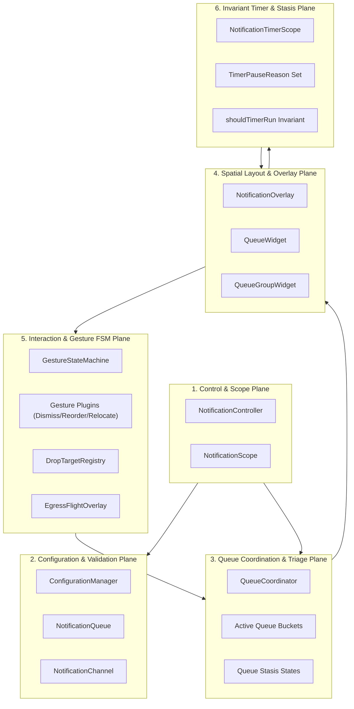
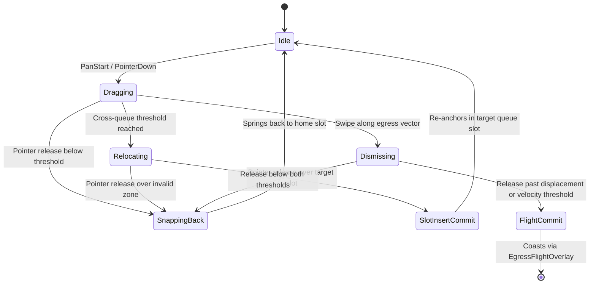
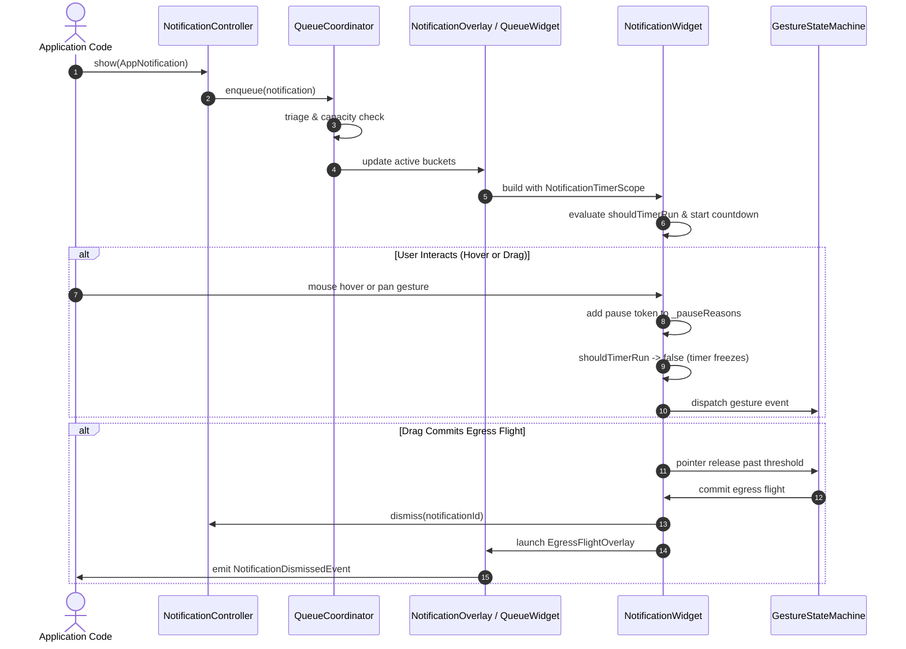

# System Architecture

This document describes the architectural topology, data flow, and subsystem
boundaries of `flutter_notification_queue` (FNQ). For the underlying design
axioms, see [philosophy.md](philosophy.md).

---

## 1. Architectural Overview

FNQ is designed as an unopinionated, modular notification orchestration
framework. It decouples message intent, domain routing, spatial queue layout,
interaction gestures, and temporal lifecycles into six distinct planes:

---

## 2. The Six Architectural Planes

### 2.1. Control & Scope Plane
The control plane provides the public entry point for applications and isolates
state to explicit widget subtrees without global singletons.

- **`NotificationController`**:
  - The single source of truth for runtime notification state.
  - Exposes dispatch APIs: `show()`, `dismiss()`, `dismissAll()`,
    `clearHistory()`, `pauseQueue()`, `resumeQueue()`, `pauseAll()`, and
    `resumeAll()`.
  - Emits notification lifecycle events via a broadcast stream
    (`controller.events`).
  - Implements multi-tenancy: multiple controllers can exist concurrently in
    separate Flutter windows, tabs, or tests without interference.

- **`NotificationScope`**:
  - An `InheritedWidget` that provides subtree access to the controller via
    `NotificationScope.of(context)`.
  - Hosts the root `OverlayPortal` to render notifications above application UI.

### 2.2. Configuration & Validation Plane
The configuration plane validates and freezes declared queues and channels
prior to queue instantiation.

- **`ConfigurationManager`**:
  - Validates `NotificationQueue` and `NotificationChannel` collections during
    controller initialization.
  - Asserts uniqueness of queue positions, validates priority boundaries, and
    ensures default channel presence.
  - Exposes immutable query methods for queue styles, channel rules, and
    capacity policies.

### 2.3. Queue Coordination & Triage Plane
The coordination plane handles dynamic notification routing, priority sorting,
capacity enforcement, and queue-level stasis.

- **`QueueCoordinator`**:
  - Manages active buckets of notifications indexed by `QueuePosition`.
  - Triages incoming `AppNotification` payloads into appropriate queues based
    on channel binding and priority levels.
  - Enforces queue constraints: capacity limits (drop-oldest vs drop-newest),
    maximum display counts, and queue stasis.
  - Orchestrates the `OverlayPortalController`, displaying the overlay only
    when active notifications exist.
  - Maintains queue pause state sets to pause countdown timers across entire
    queues during reordering, cross-queue relocation, or programmatic hold.

### 2.4. Spatial Layout & Overlay Plane
The spatial layout plane renders active notification stacks in screen
coordinates according to configurable layout styles.

- **`NotificationOverlay`**:
  - Top-level overlay entry point rendered inside Flutter's `OverlayPortal`.
  - Mounts spatial queue containers aligned to configured screen edges
    (e.g., `topRight`, `bottomCenter`, `centerLeft`).

- **`QueueWidget`**:
  - Renders a single active queue stack.
  - Applies `QueueStyle` geometry: stack offset, spacing, scale gradients,
    opacity falloffs, and maximum card visibility.
  - Integrates `NotificationTimerScope` to propagate queue-level freeze states
    down the widget subtree.

- **`QueueGroupWidget`**:
  - Manages multi-queue compositions and coordinates cross-queue animations.
  - Inherits and composes ambient `NotificationTimerScope` settings.

### 2.5. Interaction & Gesture FSM Plane
The interaction plane translates user touch, mouse, and gesture inputs into
deterministic state machine transitions.

- **`GestureStateMachine`**:
  - Central Finite State Machine governing gesture lifecycle.
  - Ensures clean exclusivity: a notification card cannot simultaneously enter
    dismiss flight and cross-queue relocation.

- **Gesture Plugins**:
  - Modular gesture behaviors attached to notification cards.
  - `DismissPlugin`: Vector-based egress detection, dynamic card tilt, and
    reveal underlay rendering.
  - `ReorderPlugin`: In-queue position swapping with live visual slot shifts.
  - `RelocatePlugin`: Cross-queue dragging with target slot insertion feedback.

- **`DropTargetRegistry`**:
  - Central spatial directory mapping screen coordinates to queue slots.
  - Provides sub-pixel hit testing for cross-queue insertion and feedback.

- **`EgressFlightOverlay`**:
  - Detaches committed dismiss cards into a global overlay portal.
  - Coasts the card off-screen at its measured release velocity while the queue
    slot collapses beneath it.

### 2.6. Invariant Timer & Stasis Plane
The timer plane manages notification countdowns under strict mathematical
invariance rules.

- **`TimerPauseReason`**:
  - Typed enum defining all valid pause triggers: `drag`, `hover`,
    `touchHold`, `expanded`, `contextMenu`, `pinned`.

- **`shouldTimerRun` Invariant**:
  - Evaluated continuously as:
    `shouldTimerRun = isTimerEnabled && _pauseReasons.isEmpty && !_isDismissing`
  - Replaces scattered boolean flags with a single, verifiable equation.

- **`NotificationTimerScope`**:
  - Widget-tree `InheritedWidget` that broadcasts ambient timer enable/disable
    state to all child notifications.
  - Used by queues to enforce temporal stasis during drag, reorder, and
    relocation gestures without mutating individual card state tokens.

---

## 3. End-to-End Data & Event Flow

The diagram below traces an `AppNotification` from dispatch to egress:

---

## 4. Key Architectural Guarantees

1. **Zero Global State**:
   All state is instance-bound to `NotificationController` and
   `QueueCoordinator`. Subtrees and tests are fully isolated.

2. **Temporal Conservation**:
   Pausing a card or queue preserves remaining duration exactly. When resumed,
   the timer counts down from the preserved remainder.

3. **Spatial Determinism**:
   Every queue slot, drop target, and relocation insertion point is registered
   in `DropTargetRegistry` with unambiguous screen bounds.

4. **1:1 API Fidelity**:
   All configurations declared in `NotificationQueue` and `QueueStyle` are
   honored by layout and gesture engines without silent overrides.
