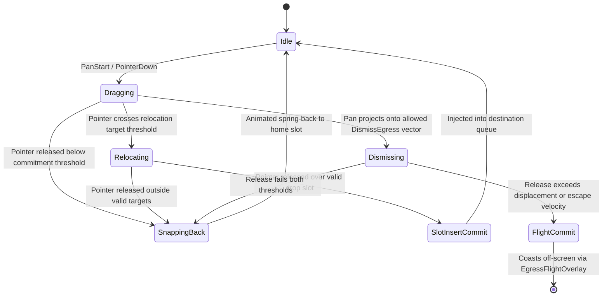
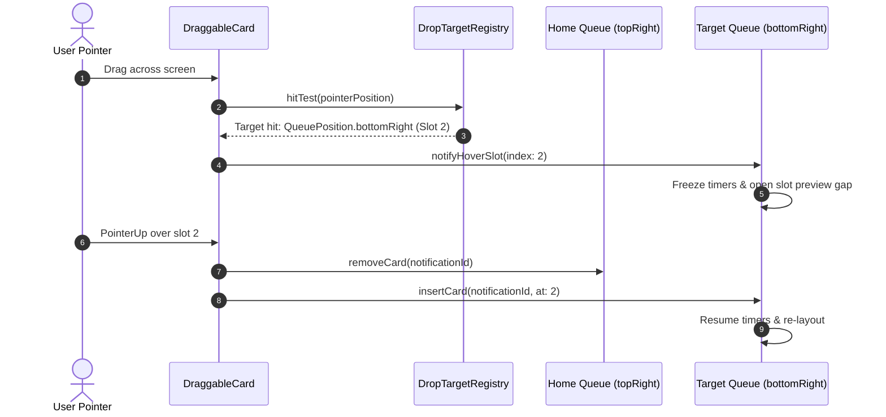

# Gestures & Spatial Interactions

This document details the gesture processing architecture, finite state
machine (FSM), spatial egress physics, and cross-queue relocation mechanics
implemented in `flutter_notification_queue` (FNQ).

---

## 1. Interaction Design Philosophy

Standard notification systems rely on blunt, screen-edge swiping or artificial
drop zones. FNQ adopts a **card-centric, physically continuous** interaction
model:

1. **Card-Centric Egress**: Gestures are evaluated relative to the card's
   resting slot and orientation, rather than hardcoded screen borders.
2. **Dual-Threshold Commitment**: Drag gestures commit to dismissal via either
   displacement percentage or dynamic escape velocity.
3. **Organic Haptic & Visual Feedback**: In-slot reveal underlays, dynamic
   angular tilt, and real-time slot preview shifts provide tactile continuity.
4. **Inertial Momentum Flight**: Released cards coast off-screen along their
   release vector in a detached flight overlay while their slot collapses.

---

## 2. Gesture Finite State Machine (FSM)

All card gestures are orchestrated through a deterministic state machine
preventing race conditions between dismiss, reorder, and relocation flows.

### State Definitions & Transitions

- **`Idle`**: Initial state or gesture reset. Normal countdown and hover active.
- **`Dragging`**: Pointer down & threshold exceeded. Timer paused; tilt active.
- **`Dismissing`**: Drag vector matches `DismissEgress`. Underlay revealed.
- **`Relocating`**: Drag enters target queue. Queue freezes; gap opens.
- **`FlightCommit`**: Release past threshold. Detached to flight overlay.
- **`SlotInsert`**: Release over slot. Transferred to target queue.
- **`SnappingBack`**: Release sub-threshold. Spring animation restores card.

---

## 3. Dismissal & Spatial Egress

Dismiss gestures are configured via `DragBehavior.dismiss(...)` on
`NotificationQueue`.

### 3.1. Egress Vectors (`DismissEgressOption`)
FNQ supports five directional egress models:

- **`DismissEgressOption.horizontal`**:
  Allows horizontal swipes left or right. Standard for mobile list
  notifications.
- **`DismissEgressOption.natural`**:
  Card swipes outwards towards the nearest screen border based on queue anchor
  position. For example, a `topRight` queue swipes right, while a `topLeft`
  queue swipes left.
- **`DismissEgressOption.outward`**:
  Swipes strictly away from the application viewport center.
- **`DismissEgressOption.cross`**:
  Allows perpendicular gestures relative to the queue's stacking axis.
- **`DismissEgressOption.any`**:
  Omnidirectional dismissal along any 360-degree angle.

### 3.2. Dual-Threshold Commitment
A dismiss gesture commits to exit flight if *either* condition is met:

1. **Displacement Fraction (`dismissThreshold`)**:
   `normalizedDisplacement >= dismissThreshold` (default: `0.40`, or 40% of
   card width/height).
2. **Ballistic Escape Velocity (`escapeVelocity`)**:
   `releaseVelocity >= escapeVelocity` (default: `600.0` dp/second). Even a
   short 15% flick commits if flicked with sufficient release speed.

### 3.3. Tactile Feedback: Tilt & Underlays
- **Dynamic Angular Tilt (`enableTilt: true`)**:
  As the card is dragged horizontally, a subtle angular rotation is applied
  proportional to displacement:
  $$
  \theta = \text{clamp}(0.08 \cdot \Delta x / W, -0.12, 0.12)
  $$
- **Reveal Underlay (`showUnderlay: true`)**:
  Beneath the moving card, an `EgressUnderlay` renders in the vacated slot.
  It displays a directional icon (e.g. `Icons.delete_outline`) whose opacity
  and scale track gesture progress.

### 3.4. Inertial Flight Overlay (`EgressFlightOverlay`)
When a card commits to dismissal:
1. The card widget detaches from the `QueueWidget` hierarchy and mounts in a
   dedicated `OverlayPortalController`.
2. The card continues coasting along its release vector at its measured exit
   velocity, decelerating with natural physics.
3. Concurrently, the source queue stack collapses the vacant slot immediately.
   Users do not wait for exit animations before interacting with remaining
   cards.

---

## 4. In-Queue Reordering

Configured via `DragBehavior.reorder()`:
- Allows users to drag notifications up or down to reprioritize cards within
  the same queue stack.
- As the card is dragged, adjacent cards translate smoothly out of the way
  to indicate the active insertion index.
- Dragging pauses countdown timers for all cards in the queue via
  `NotificationTimerScope`.
- Releasing the card re-indexes notifications in `QueueCoordinator` and
  resumes countdown timers.

---

## 5. Cross-Queue Relocation

Configured via `DragBehavior.relocate(...)` or
`DragBehavior.reorderAndRelocate(...)`:

### 5.1. Relocation Modes
- **Whole-Queue Target**:
  Dragging a card into any region of a destination queue moves it to the head
  or tail of that queue.
- **Slot-Level Insertion**:
  Target queue inspects cursor position via `DropTargetRegistry` and opens a
  visual gap at the exact target slot index. Releasing drops the card directly
  into that slot.

### 5.2. Drop Target Registry
`DropTargetRegistry` is a thread-safe spatial lookup registry that maps
global screen coordinates to queue positions and slot rectangles:

### 5.3. Error Recovery & Invalid Drops
If a card is dragged towards an unauthorized target queue or released over dead
space, the gesture FSM transitions to `SnappingBack`. A curved spring animation
returns the card to its original home slot and resumes its timer smoothly.
