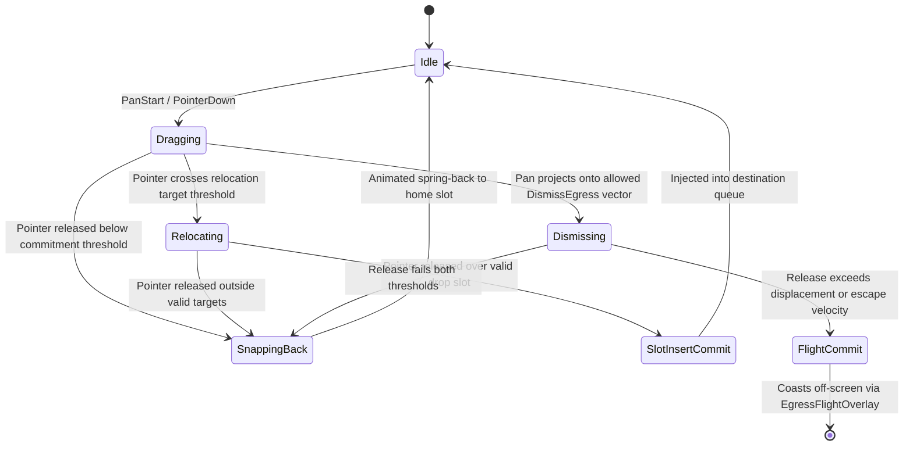
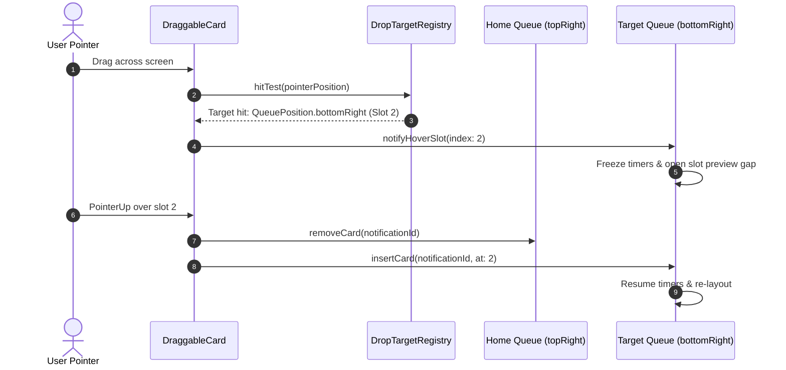

# Gestures & Spatial Interactions

This document details the gesture processing architecture, finite state
machine (FSM), spatial egress physics, and interaction taxonomy implemented in
`flutter_notification_queue` (FNQ).

---

## 1. Interaction Design Philosophy & Taxonomy

Standard notification libraries treat gestures as disconnected callbacks. FNQ
organizes card interactions into three distinct, physical interaction pillars:

1. **Spatial Egress (`Dismiss`)**:
   Physical exit along card-centric vector pathways (`DismissEgress`) governed
   by dual thresholds (displacement fraction and ballistic velocity), tactile
   tilt, in-slot reveal underlays, and detached inertial flight.
2. **Spatial Movement (`Reorder` & `Relocate`)**:
   Translating cards across physical slots. Dragging within the home queue is
   slot reordering; dragging across screen boundaries into sibling queues is
   relocation. Both share the same underlying spatial mechanics.
3. **Card Actions & Retention (`Pin`, `Snooze`, `CustomAction`)**:
   Lifecycle actions that preserve, pause, or execute custom application logic
   on a card without altering its physical queue slot.

---

## 2. Gesture Finite State Machine (FSM)

All card gestures are orchestrated through a deterministic state machine
preventing race conditions between dismiss, reorder, and relocation flows:

### State Definitions & Transitions

- **`Idle`**: Initial resting state. Normal countdown and hover active.
- **`Dragging`**: Pointer down & threshold exceeded. Timer paused; tilt active.
- **`Dismissing`**: Drag vector matches `DismissEgress`. Underlay revealed.
- **`Relocating`**: Drag enters target queue. Queue freezes; gap opens.
- **`FlightCommit`**: Release past threshold. Detached to flight overlay.
- **`SlotInsertCommit`**: Release over slot. Transferred to target queue.
- **`SnappingBack`**: Release sub-threshold. Spring animation restores card.

---

## 3. Dismissal & Spatial Egress

Dismiss gestures are configured via `DragBehavior.dismiss(...)` on
`NotificationQueue`.

### 3.1. Egress Vectors (`DismissEgressOption`)
FNQ supports five directional egress models:

- **`DismissEgressOption.horizontal`**:
  Allows horizontal swipes left or right. Standard for mobile list
  notifications.
- **`DismissEgressOption.natural`**:
  Card swipes outwards towards the nearest screen border based on queue anchor
  position. For example, a `topRight` queue swipes right, while a `topLeft`
  queue swipes left.
- **`DismissEgressOption.outward`**:
  Swipes strictly away from the application viewport center.
- **`DismissEgressOption.cross`**:
  Allows perpendicular gestures relative to the queue's stacking axis.
- **`DismissEgressOption.any`**:
  Omnidirectional dismissal along any 360-degree angle.

### 3.2. Dual-Threshold Commitment
A dismiss gesture commits to exit flight if *either* condition is met:

1. **Displacement Fraction (`dismissThreshold`)**:
   `normalizedDisplacement >= dismissThreshold` (default: `0.40`, or 40% of
   card width/height).
2. **Ballistic Escape Velocity (`escapeVelocity`)**:
   `releaseVelocity >= escapeVelocity` (default: `600.0` dp/second). Even a
   short 15% flick commits if flicked with sufficient release speed.

### 3.3. Tactile Feedback: Tilt & Underlays
- **Dynamic Angular Tilt (`enableTilt: true`)**:
  As the card is dragged horizontally, a subtle angular rotation is applied
  proportional to displacement:
  $$
  \theta = \text{clamp}(0.08 \cdot \Delta x / W, -0.12, 0.12)
  $$
- **Reveal Underlay (`showUnderlay: true`)**:
  Beneath the moving card, an `EgressUnderlay` renders in the vacated slot.
  It displays a directional icon (e.g. `Icons.delete_outline`) whose opacity
  and scale track gesture progress.

### 3.4. Inertial Flight Overlay (`EgressFlightOverlay`)
When a card commits to dismissal:
1. The card widget detaches from the `QueueWidget` hierarchy and mounts in a
   dedicated `OverlayPortalController`.
2. The card continues coasting along its release vector at its measured exit
   velocity, decelerating with natural physics.
3. Concurrently, the source queue stack collapses the vacant slot immediately.
   Users do not wait for exit animations before interacting with remaining
   cards.

---

## 4. Spatial Movement (Reorder & Relocate)

Spatial movement encompasses any gesture where the user picks up a notification
card and moves it to another physical slot.

### 4.1. The Single Underlying Continuum
In traditional thinking, in-queue reordering and cross-queue relocation are
treated as separate behaviors. In FNQ's spatial architecture, they are two
points along the same continuum:
- **Local Movement (In-Queue Reorder)**:
  Dragging a card within the boundaries of its current queue shifts neighboring
  cards to preview the new insertion index (`DragBehavior.reorder()`).
- **Cross-Queue Movement (Relocate)**:
  Dragging a card across the screen into a designated sibling queue opens an
  insertion gap in the target queue (`DragBehavior.relocate(...)`).
- **Hybrid Movement (`DragBehavior.reorderAndRelocate(...)`)**:
  Reorders locally while within the queue bounding box, but transitions into
  cross-queue relocation once dragged past `escapeThresholdInPixels`.

> [!NOTE]
> **Evolutionary Direction (v0.8.x)**:
> In `v0.7.x`, these exist as three separate classes (`Reorder`, `Relocate`,
> `ReorderAndRelocate`). In `v0.8.x`, they will be rationalized into a single
> unified spatial movement behavior (e.g. `Relocate.local()` or
> `Relocate.to(...)`), eliminating duplicated plugins and simplifying choice.

### 4.2. Drop Target Registry & Slot-Level Insertion
`DropTargetRegistry` is a spatial lookup registry that maps global screen
coordinates to queue bounds and slot gaps:

### 4.3. Error Recovery & Invalid Drops
If a card is dragged toward an unauthorized destination or released over dead
space, the gesture FSM transitions to `SnappingBack`. A curved spring animation
restores the card to its original home slot and resumes its timer smoothly.

---

## 5. Card Actions & Retention (`Pin`, `Snooze`, `CustomAction`)

Retention actions prevent notifications from expiring or temporarily park them
for later review.

### 5.1. Experimental Drag-to-Action (`@experimental`)
In early iterations, FNQ explored triggering retention via full-screen drag
behaviors (`Pin()`, `Snooze()`, `CustomAction()`). While functional, dragging an
entire notification card across the screen solely to pin or snooze it is an
unnatural interaction pattern for desktop and mobile users.

### 5.2. Evolution into a Dedicated Action Framework (v0.8.x)
In upcoming iterations, retention actions are evolving into a dedicated,
ergonomic card action model:
1. **Quick Action Pills & Header Controls**:
   Explicit icons on the card allowing one-tap pinning, snoozing, or custom
   callbacks.
2. **Desktop Context Menu (Right-Click)**:
   Already supported via FNQ's desktop context menu engine (`v0.6.1`).
3. **Partial Swipe-Reveal Actions**:
   Dragging a short distance reveals action underlays (such as a snooze clock or
   pin icon) without requiring full screen traversal.
