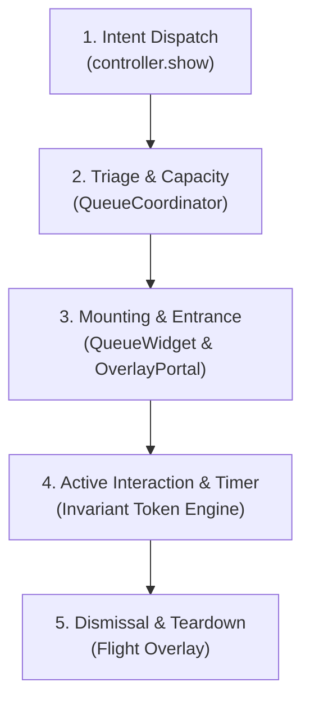

# Notification Lifecycle

Understanding the lifecycle of a notification from payload intent to teardown is
essential for debugging, customization, and event stream observation.

---

## 1. The 5 Lifecycle Stages

---

### Stage 1: Intent Dispatch
- Application code or service dispatches an `AppNotification` payload via
  `controller.show(...)`.
- `NotificationController` validates channel and queue configurations via
  `ConfigurationManager`.
- Resolves target queue (via explicit `targetPosition`, `channel.position`, or
  fallback default).
- Emits `NotificationQueued` event on `controller.events`.

---

### Stage 2: Queue Triage & Capacity Evaluation
- The notification is passed to the `QueueCoordinator`.
- Coordinator evaluates priority triage, preemption rules, and capacity limits
  (`maxStackSize`).
- If capacity is exceeded, lower-priority notifications are dropped, evicted,
  or parked according to queue policies (`QueueOverflowed` event emitted).

---

### Stage 3: Mounting & Entrance Animation
- `QueueCoordinator` ensures `OverlayPortalController` is attached via
  `NotificationScope`.
- Active `QueueWidget` mounts and renders the card into the spatial stack.
- The notification animates onto the screen using its configured entrance
  transition (`Slide`, `Scale`, `Fade`).

---

### Stage 4: Active Interaction & Invariant Timekeeping
- The card sits in the spatial stack wrapped in `NotificationTimerScope`.
- Auto-dismiss countdown runs subject to the mathematical invariant:
  `shouldTimerRun = isTimerEnabled && _pauseReasons.isEmpty && !_isDismissing`
- **Interaction Suspends Entropy (Axiom IV)**:
  - **Hover**: Cursor over card adds `TimerPauseReason.hover`.
  - **Touch Hold**: Sustained mobile contact adds `TimerPauseReason.touchHold`.
  - **Drag Gesture**: Pointer pan adds `TimerPauseReason.drag` and applies
    dynamic angular tilt (`enableTilt`) while revealing `EgressUnderlay`.
  - **Context Menu**: Opening secondary click menu adds
    `TimerPauseReason.contextMenu`.
  - **Expanded Deck**: Tapping to expand adds `TimerPauseReason.expanded`.
- **Queue-Level Stasis**:
  - Reordering or relocating cards freezes all cards across affected queues
    via `NotificationTimerScope(enabled: !isQueuePaused)`.
  - Application developers can programmatically freeze queues via
    `controller.pauseQueue(...)` or `controller.pauseAll()`.
- **Duration Conservation**:
  - Releasing an uncommitted drag or un-pausing resumes the countdown timer
    from the exact remaining millisecond duration without resetting.

---

### Stage 5: Dismissal & Teardown
- **Dismissal Trigger**:
  - Auto-dismiss timer completion (`DismissReason.timeout`).
  - User swipe past threshold or escape velocity (`DismissReason.userSwipe`).
  - User card tap action (`DismissReason.userTap`).
  - Programmatic dismissal (`controller.dismiss(...)` or
    `controller.dismissGroup(...)`).
  - Capacity eviction (`DismissReason.evicted`).
- **Idempotent Guard**:
  - `_isDismissing` flag ensures dismissal logic executes exactly once per card,
    preventing duplicate controller calls or post-dispose animations.
- **Exit Modes**:
  - **Ballistic Inertial Flight (`EgressFlightOverlay`)**:
    Committed swipe dismissals detach the card into an overlay flight portal,
    coasting off-screen at finger release velocity while the queue stack slot
    collapses immediately beneath it.
  - **In-Place Reverse Animation**:
    Timeouts and programmatic dismissals execute configured reverse
    transitions (`Slide`, `Scale`, `Fade`).
- **Teardown & Cleanup**:
  - Card state and tickers are disposed.
  - Notification entry is removed from `QueueCoordinator` active buckets.
  - `NotificationDismissed` event is emitted.
  - When all queues are empty, `QueueCoordinator` detaches the
    `OverlayPortalController` to conserve system resources.
