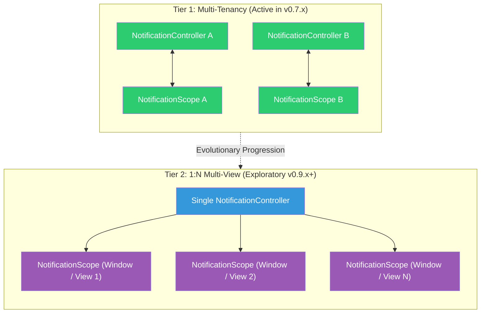

# Multi-Tenancy & Multi-Window Architecture

This document provides the authoritative architectural specification and
design rationale for **Multi-Tenancy and Multi-Window Support** in `flutter_
notification_queue` (FNQ). It defines the boundaries between multi-tenancy and
multi-view coordination, analyzes the Flutter desktop windowing landscape, and
outlines the evolutionary path from the active v0.7.x infrastructure to future
multi-view milestones.

---

## 1. Executive Summary & Core Definitions

A frequent source of architectural ambiguity in desktop and multi-surface
Flutter development is conflating **Multi-Tenancy** with **Multi-Window /
Multi-View Orchestration**. FNQ treats these as two fundamentally distinct
architectural tiers:



### 1.1. Multi-Tenancy (1:1 Model — Active in v0.7.x)
- **Definition**: The ability of FNQ to run multiple concurrent, fully isolated
  notification instances in the same application process without static state
  collisions, GlobalKey conflicts, memory leaks, or cross-talk.
- **Topology**: Each independent surface (window, tab, route subtree, or test)
  creates its own `NotificationController` and mounts its own
  `NotificationScope`.
- **Status**: **Active foundational architecture** in v0.7.x (Axiom I).
  The controller attachment invariant enforces 1:1 coupling via:
  ```dart
  assert(_attachedState == null,
      'A controller may only be used with one scope at a time.');
  ```

### 1.2. Multi-View Orchestration (1:N Model — Exploratory in v0.9.x+)
- **Definition**: The capability of a *single* `NotificationController` to
  coordinate queues, priorities, and card dispatches across multiple native OS
  windows or `FlutterView` instances simultaneously.
- **Topology**: One unified controller routes notifications to targeted or
  active windows (`controller.show(notification, targetView: windowId)`).
- **Status**: **Exploratory architectural track** scheduled for v0.9.x,
  following gesture rationalization and the stabilization of upstream Flutter
  desktop multi-view embedding APIs.

---

## 2. The Flutter Desktop Windowing Landscape

Desktop windowing in Flutter is evolving rapidly. Understanding the technical
mechanisms is essential for evaluating FNQ's architecture:

### 2.1. Model A — Multi-Engine Architecture (`desktop_multi_window`)
In this community approach, each native OS window boots its own independent
`FlutterEngine` in a separate Dart isolate:
- **Process Memory**: Memory is strictly isolated across isolates. Dart objects
  cannot be passed by reference; cross-window communication requires
  serialized platform channels (`DesktopMultiWindow.invokeMethod`).
- **Native Runners**: Requires C++ runner modifications in
  `my_application.cc` (Linux) and `flutter_window.cpp` (Windows) to register
  plugins for secondary engines.
- **Implication for FNQ**: Since isolates do not share heap memory, FNQ
  runs as completely separate instances in each window. This tests multi-tenancy
  isolation, but does not provide shared-memory view coordination.

### 2.2. Model B — Single-Engine Multi-View (`View`, `FlutterView`)
Introduced in modern Flutter SDKs (3.x+), this architecture runs multiple OS
windows from a **single Flutter engine and a single Dart isolate**:
- **Process Memory**: All windows share the exact same Dart heap. Controllers,
  BLoCs, and models can be passed directly as ordinary Dart references.
- **Widgets**: Windows are represented in the widget tree via `View` and
  `FlutterView` primitives from `flutter/widgets.dart` and `dart:ui`.
- **Implication for FNQ**: This is the official future of Flutter desktop.
  In this model, a single `NotificationController` can theoretically drive
  multiple `NotificationScope` instances across multiple views without
  serialization hacks.

### 2.3. Model C — In-Studio Virtual Split-Viewports (Zero-Dependency)
Simulates multi-tenant surfaces within a single Flutter window by rendering two
or more independent `NotificationScope` subtrees side-by-side in custom frames:
- **Process Memory**: Same Dart heap, standard widget tree.
- **Dependencies**: **Zero** third-party packages, zero native C++ changes.
- **Portability**: 100% cross-platform (runs identically on Linux, Windows,
  macOS, Web, Android, iOS, and in headless `flutter test`).
- **Implication for FNQ**: Provides the ideal crucible for validating
  v0.7.x multi-tenancy (testing state isolation, independent stasis tokens,
  and drop target registry boundaries) without platform flakiness.

---

## 3. The Zero-Dependency Principle

A core architectural invariant of FNQ is:
> **`flutter_notification_queue` is an overlay orchestration library, NOT an
> OS window manager.**

The core package must remain **100% zero-dependency** regarding desktop
windowing for three decisive reasons:

1. **Zero Vendor Lock-in**:
   FNQ must never force app developers into a specific windowing plugin.
   Whether a developer chooses `desktop_multi_window`, native Add-to-App
   engines, or Flutter multi-view, FNQ functions seamlessly because it relies
   only on standard Flutter `BuildContext` and `OverlayPortal`.

2. **Immunity to Platform Runner Churn**:
   Native C++ runner templates in Flutter desktop undergo periodic breaking
   changes. Third-party windowing plugins frequently break during Flutter SDK
   upgrades. Keeping FNQ pure Dart ensures it never breaks a developer's
   native build.

3. **Deterministic CI/CD Automation**:
   Headless Linux build machines on GitHub Actions do not have X11/Wayland
   display servers to spawn native OS windows. A zero-dependency multi-tenancy
   model allows FNQ's test suite (`flutter test`) to verify concurrent
   controllers in headless memory in milliseconds.

---

## 4. Why 1:N Multi-View Belongs in v0.9.x (Not v0.7.x or v0.8.x)

Attempting to implement 1:N multi-view coordination in the current v0.7.x
release would be an architectural anti-pattern:

### 4.1. Avoid Building on Code Scheduled for Replacement
In v0.8.x, FNQ will unify the spatial movement plugins (`Reorder`, `Relocate`,
`ReorderAndRelocate`) into a single engine, rationalize `Pin` and `Snooze` into
dedicated card actions, and purge ~1,200 lines of legacy `DismissZone` dead
code. 

Adapting three separate movement plugins and dead screen-edge zone code to
multi-view in v0.7.x—only to tear them down and rewrite them in v0.8.x—would be
pure waste.

### 4.2. Upstream Flutter Multi-View Stabilization
While Flutter's `View` and `FlutterView` primitives are available in the SDK,
desktop multi-view embedding (opening native OS windows without custom C++
embedders) is still stabilizing upstream. Designing 1:N orchestration in v0.9.x
ensures FNQ builds upon a settled, production-grade Flutter standard.

### 4.3. Preserving the Core Mandate of v0.7.x
The mandate for v0.7.x is **infrastructure maturation and solidifying
fundamentals**:
- Verifying the token invariant engine (`TimerPauseReason`).
- Hardening queue stasis (`NotificationTimerScope`).
- Stress-testing physical egress physics and slot relocation.
- Proving that 1:1 multi-tenancy is completely leak-free and isolated.

---

## 5. Architectural Blueprint for 1:N Multi-View (v0.9.x Horizon)

When FNQ approaches the v0.9.x multi-view milestone, the transition from 1:1 to
1:N will be guided by the following architectural blueprint:

### 5.1. View Registry Inside `NotificationController`
Replace the scalar `_attachedState` with a view-keyed registry:
```dart
// v0.9.x Target Architecture:
final Map<int, NotificationScopeState> _attachedViews =
    <int, NotificationScopeState>{};
```

### 5.2. View-Aware Dispatch Ergonomics
Provide clean targeting while preserving default convenience:
```dart
// 1. Dispatch to the currently active/focused window (default):
controller.show(notification);

// 2. Dispatch to an explicit target window:
controller.show(notification, targetView: windowId);

// 3. Broadcast across all active windows:
controller.show(notification, broadcast: true);
```

### 5.3. Scoped Overlay Portals & Coordinate Invariance
Each `NotificationScope` attached to a view will bind its `OverlayPortal` and
`DropTargetRegistry` strictly to `View.of(context)`:
- Coordinate conversions (`localToGlobal`) will be evaluated relative to the
  view's local coordinate space, preventing cross-monitor displacement bugs.
- DPI scaling differences across multi-monitor setups will be resolved
  natively via `MediaQuery.of(context).devicePixelRatio`.

---

## 6. Multi-Tenancy Validation Strategy in Studio (v0.7.x)

To battle-test v0.7.x multi-tenancy without third-party dependencies, the
Studio example app (`example/`) incorporates a **Multi-Tenant Split-Viewport
Stage**:

1. **Dual Independent Workspaces**:
   Two distinct viewports ("Workspace A" and "Workspace B") render side-by-side.
2. **Dedicated Controllers & Scopes**:
   Each workspace instantiates its own `NotificationController`, registers its
   own queues and channels, and mounts its own `NotificationScope`.
3. **Stress Invariants to Verify**:
   - **Stasis Isolation**: Calling `pauseQueue()` on Workspace A must NOT halt
     timers in Workspace B.
   - **Registry Isolation**: Dragging a notification card in Workspace A must
     never highlight or insert into drop target slots in Workspace B.
   - **Event Isolation**: `controllerA.events` must stream only events
     dispatched within Workspace A.
   - **Teardown Safety**: Toggling Workspace B off (unmounting its widget tree)
     must trigger idempotent controller and coordinator disposal with zero
     orphan tickers or unhandled stream errors.
