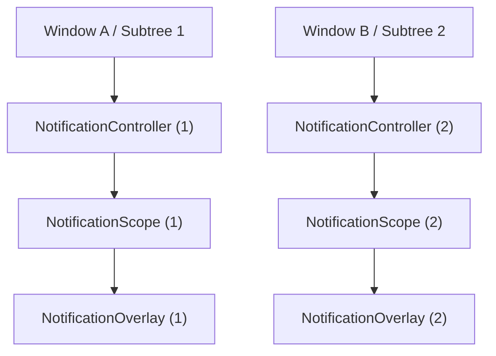
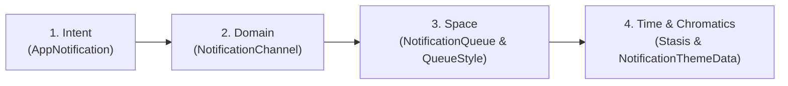
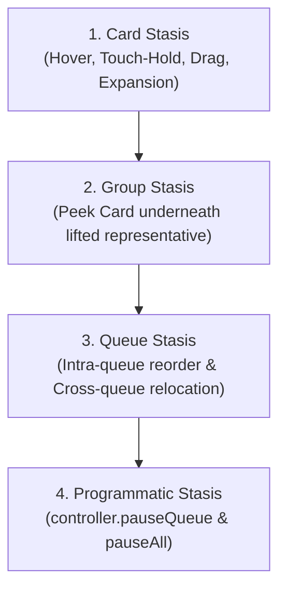
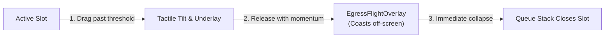

# The Philosophy & Architectural Principles of FNQ

> [!NOTE]
> This document formalizes the architectural principles, mental models, and
> design axioms that guide **Flutter Notification Queue (FNQ)**. These axioms
> are not rigid dogmas, but living engineering principles that are actively
> stress-tested, refined, and validated against real-world Flutter apps.

---

## 1. Executive Manifesto

Most notification libraries in the UI ecosystem treat notifications as
ephemeral toast popups—floating overlays spawned on an ad-hoc basis, tethered
to global singletons, and governed by detached timers.

FNQ rethinks notifications from first principles. In modern applications,
notifications are **spatial UI entities** with domain semantics, stacking
mechanics, and physical interactions. They must respect:

- **Multi-Tenancy**: Supporting multi-window desktop environments, independent
  embedded subtrees, and isolated unit tests.
- **Physical Continuity**: Operating with organic inertia, tactile feedback,
  and card-relative egress rather than arbitrary screen borders.
- **Temporal Stasis**: Guaranteeing that cards never expire or disappear while
  the user is actively touching, dragging, hovering, or reading them.
- **Mathematical Invariance**: Eliminating race conditions and state clobbering
  by replacing loose boolean flags with token sets and finite state machines.

---

## 2. Axiom I: Multi-Tenancy & Zero Singletons



### The Principle
There is **zero global mutable state** and **no static singleton manager** in
FNQ. State is strictly instance-bound.

### The Rationale
Modern Flutter applications run across multiple windows (desktop), embedded
engines (`FlutterEngine` in Add-to-App), and isolated route subtrees. Static
singletons make it impossible to:
1. Run independent notification surfaces per desktop window.
2. Isolate notification contexts in tests without manual `reset()` teardowns.
3. Host dedicated, scoped queues within specific dashboard subtrees.

### Canonical Pattern
FNQ follows the Flutter SDK's `TextEditingController` ↔ `TextField` and
`ScaffoldMessenger` pattern:
- **`NotificationController`**: Pure-Dart configuration owner, lifecycle
  manager, and contextless dispatch handle.
- **`NotificationScope`**: Single widget-tree injector that mounts the
  `OverlayPortal` and provides `NotificationScope.of(context)` lookup.

### Multi-Tenancy vs. Multi-Window Orchestration
In v0.7.x, Axiom I guarantees **1:1 multi-tenancy**: multiple independent
`NotificationController` and `NotificationScope` pairs can exist simultaneously
without collisions or leaks. This provides the foundation for future **1:N
multi-view orchestration** (a single controller coordinating across multiple
`FlutterView`s), targeted for v0.9.x once upstream Flutter desktop multi-view
settles.

Crucially, **FNQ is an overlay orchestration framework, not an OS window
manager**. The core package remains 100% zero-dependency, relying strictly on
standard Flutter `BuildContext` and `OverlayPortal`. For full architectural
analysis, see [multi_window_and_tenancy.md](multi_window_and_tenancy.md).

---

## 3. Axiom II: Strict Separation of the 4 Gears



FNQ partitions responsibilities into four strictly orthogonal planes that never
mutate or conflate one another:

### Gear 1: Intent (Data Plane)
- **Component**: `AppNotification`
- **Responsibility**: Pure data payload (`title`, `message`, `priority`,
  `action`).
- **Purity**: Passive and immutable. An `AppNotification` has no knowledge of
  where it will appear, how it will animate, or how long it will live.

### Gear 2: Domain (Routing & Semantic Plane)
- **Component**: `NotificationChannel`
- **Responsibility**: Categorizes alerts by domain topic (`billing`, `chat`,
  `security`, `alerts`).
- **Decoupling**: Channels define default target queue positions and semantic
  theming defaults, shielding application services from physical screen layout
  details.

### Gear 3: Space (Spatial & Anatomy Plane)
- **Component**: `NotificationQueue` and `QueueStyle`
- **Responsibility**: Governs *where* notifications manifest on screen
  (`QueuePosition`), stack capacity (`maxStackSize`), eviction strategies,
  margin/spacing, layout geometry (Filled, Outlined, Flat), and gesture
  behaviors (`Dismiss`, `Reorder`, `Relocate`).

### Gear 4: Time & Chromatics (Temporal & Styling Plane)
- **Time**: Auto-dismiss timers, token-based pause accounting, and queue stasis
  scopes.
- **Chromatics**: `NotificationThemeData` provides semantic color tokens,
  typography, and visual accents without altering layout geometry.

---

## 4. Axiom III: Mathematical Invariance (Tokens Over Flags)

```
❌ BAD (Loose Flags):
_isHovered = true;
_isDragging = true;
onExit() -> _isHovered = false; // BUG: Resumes timer while still dragging!

✅ GOOD (Token Invariant Set):
_pauseReasons = {hover, drag};
onExit() -> _pauseReasons.remove(hover);
shouldTimerRun => _pauseReasons.isEmpty; // Still paused by drag token!
```

### The Problem with Boolean Flags
In complex interactive UI cards, multiple orthogonal states can overlap:
- A user hovers over a card with their mouse while an auto-dismiss timer ticks.
- While hovered, they begin dragging the card.
- The drag moves slightly, causing the mouse region to emit `onExit`.
- If the card uses loose flags (`_isHovered = false`), the exit handler might
  restart the timer while the card is still being dragged, causing it to vanish
  mid-gesture.

### The Invariant Solution
All pause conditions in FNQ are represented as explicit tokens in a set:
```dart
enum TimerPauseReason {
  drag,
  hover,
  touchHold,
  expanded,
  contextMenu,
  pinned,
}
```
A notification's auto-dismiss timer ticks if and only if the invariant holds:
```dart
bool get shouldTimerRun =>
    resolvedDismissDuration != null &&
    !widget.permanent &&
    !widget.isPinned &&
    _pauseReasons.isEmpty &&
    mounted &&
    !_isDisposed &&
    NotificationTimerScope.isEnabledNonSubscribing(context);
```
Releasing any one interaction removes only its specific token. Overlapping
interactions can never clobber each other.

---

## 5. Axiom IV: Temporal Stasis (Interaction Suspends Entropy)

### The Principle
**User interaction suspends entropy.** A notification card must never expire,
shrink, or disappear while a user is actively engaging with it or with its
parent queue.

### The 4 Tiers of Stasis



1. **Card-Level Stasis**:
   - Touching, dragging, hovering, or expanding a card adds a pause token and
     halts the countdown ticker.
   - When the gesture ends without commitment (snap-back), the timer resumes
     from its exact remaining duration—no timer loss and no resets.
2. **Group-Level Stasis**:
   - Lifting a representative card in a bundle reveals the peek card beneath in
     dormant stasis (`opacity = 0.55`) with its timer frozen.
   - Expanding a bundle halts timers across all cards in the deck.
3. **Queue-Level Stasis**:
   - **Reorder Stasis**: Dragging a card to reorder pauses timers across all
     sibling cards in the queue so cards do not dismiss while finding a slot.
   - **Relocation Stasis**: When a card is dragged between queues, both the
     source and target queues freeze their timers.
4. **Programmatic Stasis**:
   - Applications can freeze an entire queue (`controller.pauseQueue(position)`)
     or all queues (`controller.pauseAll()`) during modals, tutorials, or app
     backgrounding, resuming cleanly afterwards.

---

## 6. Axiom V: Spatial & Physical Continuity



### The Principle
Transitions must preserve physical momentum and spatial context rather than
relying on disconnected pop-in/pop-out animations.

### Core Mechanics
- **Card-Centric Egress (`DismissEgress`)**: Swipe dismissal follows vectors
  relative to the card's resting slot (`horizontal`, `natural`, `outward`,
  `cross`, `any`), replacing artificial screen-edge drop zones.
- **Dual-Threshold Commitment**: Cards commit either by displacement fraction
  (`dismissThreshold: 0.40`) or ballistic escape velocity
  (`escapeVelocity: 600.0 dp/s`).
- **Tactile Angular Tilt (`enableTilt`)**: Proportional card rotation during
  drag produces an organic, physical feel.
- **In-Slot Reveal Underlay (`EgressUnderlay`)**: Moving the card reveals a
  tinted backdrop with `dismissIcon` scaled to gesture progress.
- **Inertial Momentum Flight (`EgressFlightOverlay`)**: Upon release past
  threshold, the card detaches into an overlay portal and coasts off-screen at
  its exact release velocity, while the source slot in the queue collapses
  immediately beneath it.
- **Unified Spatial Movement**: Translating cards across slots (in-queue slot
  reordering and cross-queue relocation) operates as a continuous spatial
  mechanic rather than disconnected gesture modes.
- **Dedicated Retention Actions**: Operations like pinning and snoozing act on
  card lifecycle through contextual controls, rather than synthetic full-card
  drag interactions.

---

## 7. Summary Matrix of the 5 Axioms

| Axiom | Core Concept | Failure Prevented |
|---|---|---|
| **I. Multi-Tenancy** | Zero static singletons | Multi-window leaks |
| **II. Four Gears** | Separation of 4 planes | Monolithic coupling |
| **III. Invariance** | Token set accounting | Timer clobbering & races |
| **IV. Temporal Stasis** | Interaction freezes time | Disappearing under hand |
| **V. Physicality** | Momentum flight | Clumsy animation delays |
