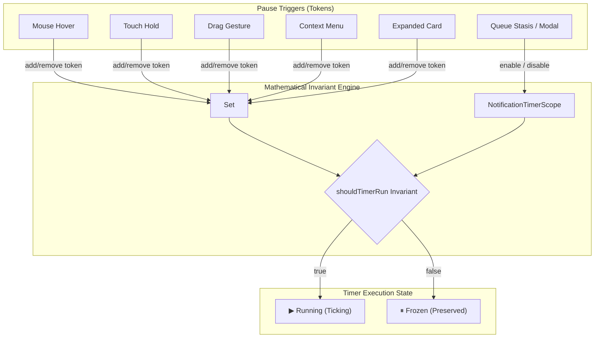

# Temporal Invariance & Queue Stasis

This document details the timekeeping architecture, token-based pause engine,
and queue stasis subsystem of `flutter_notification_queue` (FNQ).

---

## 1. Temporal Philosophy: Interaction Suspends Entropy

In traditional notification UI, cards frequently dismiss themselves while the
user is reading, hovering, or attempting to tap an action. FNQ treats time as a
controllable physical dimension governed by **Axiom IV (Temporal Stasis)**:

> **Core Principle**: Any user engagement with a notification card or its
> containing queue suspends the countdown timer. Releasing engagement resumes
> the timer from its exact remaining millisecond duration.



---

## 2. The Token-Based Invariant Engine

Earlier architectures used independent boolean flags (`_isHovering`,
`_isDragging`, `_isPaused`). When multiple interactions overlapped (e.g.,
hovering while dragging, or opening a context menu during a hover), one gesture
finishing would clear its flag and inadvertently resume the timer.

FNQ replaces all loose flags with a discrete **Token Set Engine**:

```dart
enum TimerPauseReason {
  drag,
  hover,
  touchHold,
  expanded,
  contextMenu,
  pinned,
}
```

### 2.1. The Single Invariant Equation
The card's timer running state is evaluated strictly through the invariant:

```dart
bool get shouldTimerRun =>
    NotificationTimerScope.isEnabledNonSubscribing(context) &&
    _pauseReasons.isEmpty &&
    !_isDismissing;
```

If **any** token exists in `_pauseReasons`, or if the ambient
`NotificationTimerScope` is disabled, or if the card is already in dismiss
flight, `shouldTimerRun` evaluates to `false` and the countdown halts.

---

## 3. The Hierarchy of Temporal Stasis

FNQ enforces stasis across three distinct structural tiers:

### 3.1. Card-Level Stasis
Triggered directly on the individual `NotificationWidget`:
- **Hover (`TimerPauseReason.hover`)**: Activated via `MouseRegion.onEnter`
  and released on `MouseRegion.onExit`.
- **Touch Hold (`TimerPauseReason.touchHold`)**: Activated on mobile long-press
  or sustained touch contact.
- **Drag (`TimerPauseReason.drag`)**: Activated as soon as pointer panning
  commences; released when the card commits or snaps back.
- **Expanded (`TimerPauseReason.expanded`)**: Activated when a user taps a card
  to inspect extended content (`TapBehavior.expand`).
- **Context Menu (`TimerPauseReason.contextMenu`)**: Activated when a secondary
  click or desktop right-click menu is opened.
- **Pinned (`TimerPauseReason.pinned`)**: Explicitly marks a notification as
  permanent until user dismisses it manually.

### 3.2. Group-Level Stasis
When a queue group is expanded into a multi-card peek stack
(`GroupingBehavior`), timer countdowns across all cards in the group are
frozen so the user can inspect stacked items without cards expiring.

### 3.3. Queue-Level Stasis
The entire queue stack can be frozen globally without mutating individual card
token sets. Queue stasis is managed via `QueueCoordinator` and propagated via
`NotificationTimerScope`:

- **In-Queue Reorder Stasis**: While a user is dragging a card to reorder it,
  the entire queue's timer scope is disabled so other cards do not expire.
- **Cross-Queue Relocation Stasis**: When a card is dragged between queues,
  both the home queue and the target queue are frozen simultaneously.
- **Application Modals & Backgrounding**: Developers can halt all active
  countdown timers during modals, onboarding flows, or app lifecycle pauses.

---

## 4. Queue Stasis API

`NotificationController` provides direct programmatic controls for queue
stasis:

```dart
// Pause a specific queue position (e.g. during a contextual tutorial)
controller.pauseQueue(QueuePosition.topRight);

// Inspect if a queue is paused
final bool isPaused = controller.isQueuePaused(QueuePosition.topRight);

// Resume the queue countdowns
controller.resumeQueue(QueuePosition.topRight);

// Pause all queues (e.g. app backgrounded or blocking modal opened)
controller.pauseAll();

// Resume all queues
controller.resumeAll();
```

---

## 5. `NotificationTimerScope` Architecture

`NotificationTimerScope` is an `InheritedWidget` that acts as the temporal
bus between queues and individual notification cards:

```dart
class NotificationTimerScope extends InheritedWidget {
  const NotificationTimerScope({
    super.key,
    required this.enabled,
    required super.child,
  });

  final bool enabled;

  // Reactive subscription: used in didChangeDependencies()
  static bool isEnabled(BuildContext context) {
    final scope =
        context.dependOnInheritedWidgetOfExactType<NotificationTimerScope>();
    return scope?.enabled ?? true;
  }

  // Non-subscribing check: safe for initState() and invariant getters
  static bool isEnabledNonSubscribing(BuildContext context) {
    final scope =
        context.getInheritedWidgetOfExactType<NotificationTimerScope>();
    return scope?.enabled ?? true;
  }
}
```

### Composition Across Queue Widgets
1. `QueueWidget` wraps its rendered stack in a `NotificationTimerScope`
   configured with `enabled: !isQueuePaused`.
2. `QueueGroupWidget` reads parent timer scope settings and composes them:
   `NotificationTimerScope.isEnabledNonSubscribing(context)`.
3. `NotificationWidget` establishes a reactive listener in
   `didChangeDependencies()`. When the ambient scope flips, the card
   reevaluates `shouldTimerRun` and updates its `AnimationController`.

---

## 6. Duration Conservation & Snap-Back Mechanics

When a card or queue is paused:
1. The running `AnimationController` records its current progress value
   `t = controller.value`.
2. The remaining duration is calculated as:
   $$d_{\text{remaining}} = d_{\text{total}} \times (1.0 - t)$$
3. The ticker is stopped via `controller.stop()`.
4. When resumed, `controller.animateTo(1.0, duration: d_remaining)` is
   called. The countdown resumes smoothly with zero time lost and zero
   unintended resets.
