# FNQ Unified Development Roadmap & Tracking Board

> **Current Version**: 0.7.0 (with 0.7.1 in active development)  
> **Strategic Focus**: Directional Egress Modernization, Cross-Queue Relocation, and Architecture Hardening towards v0.8.0 / v1.0.  
> **Baseline Quality**: `flutter analyze --fatal-warnings` — 0 issues | `flutter test` — 403/403 passing | `example test` — 55/55 passing.

---

## 🧭 Strategic Release Tracks

```mermaid
graph LR
    A["v0.5.2<br/>Grouping UX & Perf<br/>(✅ Completed)"] --> B["v0.6.0<br/>Monolith Decomposition<br/>(✅ Completed)"]
    B --> C["v0.6.1<br/>A11y & Context Menu<br/>(✅ Completed)"]
    C --> D["v0.7.0<br/>Relocation & Egress<br/>(✅ Completed)"]
    D --> E["v0.7.1<br/>Egress Visuals & Inertia<br/>(✅ Completed)"]
    E --> F["v0.8.0<br/>Deprecation Removal<br/>(🔵 Scheduled)"]
    F --> G["v1.0.0<br/>Production Ready GA<br/>(🎯 Target)"]

    style A fill:#2ecc71,color:#fff
    style B fill:#2ecc71,color:#fff
    style C fill:#2ecc71,color:#fff
    style D fill:#2ecc71,color:#fff
    style E fill:#2ecc71,color:#fff
    style F fill:#3498db,color:#fff
    style G fill:#e74c3c,color:#fff
```



| Release | Focus / Theme | Status | Key Deliverables |
|---|---|---|---|
| **v0.5.0** | **Stability Foundation** | ✅ Completed | Snooze timer cleanup, idempotent disposal, error handler chaining, single source-of-truth pinning, golden test tolerance. |
| **v0.5.1** | **Account Migration** | ✅ Completed | Repository, homepage, documentation, and tooling links migrated to `pccria`. |
| **v0.5.2** | **Grouping UX & Performance** | ✅ Completed | `GroupCountBehavior` hierarchy, peek card timer stasis, drag auto-dismiss suspension, atomic bundle dismiss, `CurvedAnimation` leak fixes, relocation safety. |
| **v0.6.0** | **Monolith Decomposition** | ✅ Completed | Decompose 26-file `notification.dart` monolith, extract theme & interaction modules, DRY coordinator resolution mixin, configuration immutability. |
| **v0.6.1** | **Platform & A11y Polish** | ✅ Completed | Semantic accessibility options, desktop context menu engine, focus traversal, modifier key isolation, golden test matrix. |
| **v0.7.0** | **Relocation & Egress Foundation** | ✅ Completed | Cross-queue slot relocation with live previews, sealed `DismissEgress` hierarchy (`horizontal`, `natural`, `outward`, `cross`, `any`), `DismissZone` deprecation. |
| **v0.7.1** | **Egress Visuals & Inertial Flight** | ✅ Completed | In-slot reveal underlay (`EgressUnderlay`), card tilt feedback, inertial momentum flight portal (`EgressFlightOverlay`), drag timer stasis & resume. |
| **v0.8.0** | **Deprecation Removal & Purity** | 📅 Scheduled | Complete removal of deprecated `DismissZone` and `Dismiss.zones`, deletion of legacy drop target machinery (~1,200 LOC dead code cleanup). |
| **v1.0.0** | **Production GA** | 🎯 Target | Public API freeze, 100% test coverage on critical paths, full multi-window support, zero memory leaks. |

---

## 📊 Status Board & Complexity Matrix

```
Priority Tiers:
🔴 P0 (Critical) : Eliminates crash vectors, resource leaks, or correctness bugs.
🟡 P1 (High)     : High-impact performance optimizations and architectural guardrails.
🟢 P2 (Medium)   : Code quality improvements, ergonomics, and accessibility enhancements.
🔵 P3 (Low)      : Edge-case optimizations and cosmetic styling refinements.

Complexity Tiers:
🟢 Low    : Localized parameter adjustments, documentation, or basic unit tests.
🟡 Medium : State machine updates, lifecycle coordination, caching, or data model changes.
🔴 High   : Cross-subsystem refactorings, multi-file monolith decomposition, or layout pipeline shifts.
```

---

## 📋 Comprehensive Task Tracking Boards

### Track 1: Release 0.5.0 — Stability Foundation (Completed ✅)

| ID | Task Description | Priority | Complexity | Status | Target Files |
|---|---|---|---|---|---|
| **S-01** | Track and cancel snooze timers on coordinator detach/dispose | 🔴 P0 | 🟢 Low | ✅ Completed | `lib/src/core/queue_coordinator.dart` |
| **S-02** | Add `_isDisposed` guard & idempotent disposal to controller and coordinator | 🔴 P0 | 🟢 Low | ✅ Completed | `lib/src/core/notification_controller.dart`, `lib/src/core/queue_coordinator.dart` |
| **S-03** | Fix `FlutterError.onError` chaining (non-destructive handler preservation) | 🔴 P0 | 🟢 Low | ✅ Completed | `lib/src/core/notification_controller.dart` |
| **S-04** | Replace bare `on Object catch (_) {}` with structured contextual logging | 🟡 P1 | 🟢 Low | ✅ Completed | `lib/src/core/queue_coordinator.dart` |
| **S-05** | Unify `isPinned` state: single source-of-truth via `blueprint.isPinnedNotifier` | 🟡 P1 | 🟡 Medium | ✅ Completed | `lib/src/core/notification_entry.dart`, `lib/src/core/queue_coordinator.dart` |
| **S-06** | Add `_isDisposed` guard to snooze timer auto-requeue callback | 🟡 P1 | 🟢 Low | ✅ Completed | `lib/src/core/queue_coordinator.dart` |
| **S-07** | Regenerate goldens & configure `_TolerantGoldenComparator` (0.5% tolerance) | 🟡 P1 | 🟢 Low | ✅ Completed | `test/golden/visual_regression_test.dart` |
| **S-08** | Resolve all open `todo` blocks in source code with definitive documentation | 🟢 P2 | 🟢 Low | ✅ Completed | `lib/src/notification/app_notification.dart`, `lib/src/notification/theme/notification_theme.dart`, `lib/src/notification/notification.dart` |

---

### Track 2: Release 0.5.2 — Grouping UX & Performance Polish (Completed ✅)

| ID | Task Description | Priority | Complexity | Status | Target Files |
|---|---|---|---|---|---|
| **G-01** | Configurable group count API (`GroupCountBehavior`: `HiddenCount`, `TotalCount`, `NoCount`, `CustomCount`) | 🔴 P0 | 🟡 Medium | ✅ Completed | `lib/src/notification_queue/group_count_behavior.dart`, `queue_grouping_behavior.dart` |
| **G-02** | Peek card timer stasis & drag auto-dismiss suspension on representative cards | 🔴 P0 | 🟡 Medium | ✅ Completed | `draggable_transitions.dart`, `queue_group_widget.dart` |
| **G-03** | Atomic whole-bundle dismiss & backlog purging | 🔴 P0 | 🟡 Medium | ✅ Completed | `lib/src/core/queue_coordinator.dart`, `queue_group_widget.dart` |
| **P-01** | CurvedAnimation ticker leak prevention across drag snap-back & collapse | 🔴 P0 | 🟢 Low | ✅ Completed | `draggable_transitions.dart`, `queue_group_widget.dart` |
| **P-02** | Relocation mapping integrity & duplicate GlobalKey collision hardening | 🟡 P1 | 🟢 Low | ✅ Completed | `lib/src/core/queue_coordinator.dart` |
| **P-03** | Context-aware `View.maybeOf(context)` multi-window modernization | 🟡 P1 | 🟢 Low | ✅ Completed | `lib/src/core/notification_overlay.dart` |
| **P-04** | Reorder 120Hz smoothness with memoized layout snapshots | 🟡 P1 | 🟢 Low | ✅ Completed | `lib/src/notification_queue/queue_widget.dart` |

---

### Track 3: Release 0.6.0 — Architecture & Encapsulation (Completed ✅)

| ID | Task Description | Priority | Complexity | Status | Target Files |
|---|---|---|---|---|---|
| **A-01** | Decompose 26-file `notification.dart` `part` monolith into distinct sub-libraries | 🟡 P1 | 🔴 High | ✅ Completed | `lib/src/notification/` |
| **A-02** | Extract `NotificationTheme` system from notification `part` into standalone library | 🟡 P1 | 🟡 Medium | ✅ Completed | `lib/src/notification/theme/notification_theme.dart` |
| **A-03** | Extract duplicate coordinator resolution into shared mixin (`CoordinatorResolver`) | 🟢 P2 | 🟢 Low | ✅ Completed | `lib/src/notification/notification.dart`, `lib/src/notification/interaction/widgets/draggable_transitions.dart`, `lib/src/notification_queue/queue_widget.dart` |
| **A-04** | Encapsulate `ConfigurationManager` fields (make private, enforce immutability) | 🟢 P2 | 🟢 Low | ✅ Completed | `lib/src/core/configuration_manager.dart` |
| **A-05** | Add `NotificationWidget? get notification` accessor to sealed `NotificationEvent` | 🟢 P2 | 🟢 Low | ✅ Completed | `lib/src/core/notification_event.dart`, `lib/src/core/history_logger.dart` |
| **A-06** | Replace static mutable `_idCounter` with instance-scoped ID generator | 🟢 P2 | 🟢 Low | ✅ Completed | `lib/src/notification/notification.dart` |
| **A-07** | Enforce 3-Tier Hierarchy: Deprecate per-notification `dragBehavior` physics overrides | 🟡 P1 | 🟡 Medium | ✅ Completed | `lib/src/notification/app_notification.dart`, `lib/src/notification/notification.dart` |
| **A-08** | Migrate channel & notification theming to `NotificationThemeData`; eliminate loose scalar colors | 🟡 P1 | 🟡 Medium | ✅ Completed | `lib/src/notification_channel/notification_channel.dart`, `lib/src/notification/app_notification.dart` |
| **A-09** | Decouple `AppNotification.position`: route via channel defaults or `controller.show(..., targetPosition:)` | 🟡 P1 | 🟢 Low | ✅ Completed | `lib/src/notification/app_notification.dart`, `lib/src/core/notification_controller.dart` |
| **A-10** | Payload hygiene: remove leaked `snoozedAt` from public constructor, unify `permanent` vs `initialIsPinned` | 🟢 P2 | 🟢 Low | ✅ Completed | `lib/src/notification/app_notification.dart`, `lib/src/core/notification_entry.dart` |

---

### Track 5: Release 0.7.0 / 0.7.1 — Egress Modernization & Spatial Relocation (Completed ✅)

| ID | Task Description | Priority | Complexity | Status | Target Files |
|---|---|---|---|---|---|
| **E-01** | Sealed `DismissEgress` hierarchy (`horizontal`, `natural`, `outward`, `cross`, `any`) | 🔴 P0 | 🟡 Medium | ✅ Completed | `lib/src/notification/interaction/behaviors/drag_behavior.dart` |
| **E-02** | Dual-threshold commitment (displacement fraction `dismissThreshold` + `escapeVelocity`) | 🔴 P0 | 🟡 Medium | ✅ Completed | `lib/src/notification/interaction/widgets/draggable_transitions.dart` |
| **E-03** | In-slot reveal underlay (`EgressUnderlay`) and tactile card tilt feedback | 🟡 P1 | 🟡 Medium | ✅ Completed | `lib/src/notification/interaction/widgets/egress_underlay.dart` |
| **E-04** | Inertial exit flight portal (`EgressFlightOverlay`) with release velocity conservation | 🟡 P1 | 🟡 Medium | ✅ Completed | `lib/src/notification/interaction/widgets/egress_flight_overlay.dart` |
| **E-05** | Auto-dismiss timer preservation across drag start/cancel (`pauseDismissTimer` / `resumeDismissTimer`) | 🔴 P0 | 🟢 Low | ✅ Completed | `lib/src/notification/notification_widget_state.dart` |
| **E-06** | Cross-queue slot relocation engine with live destination insertion previews | 🔴 P0 | 🔴 High | ✅ Completed | `lib/src/notification/interaction/plugins/relocate_gesture_plugin.dart`, `queue_coordinator.dart` |
| **E-07** | Keyboard modifier key isolation (`Ctrl`, `Cmd`, `Alt`, `Shift`) and post-drag card `unfocus()` | 🟢 P2 | 🟢 Low | ✅ Completed | `lib/src/notification/notification.dart` |
| **E-08** | Schedule `DismissZone` and `Dismiss.zones` deprecation for removal in `v0.8.0` | 🟡 P1 | 🟢 Low | ✅ Completed | `lib/src/notification/interaction/behaviors/` |
| **E-09** | Harmonize `Relocate` with whole-queue container semantics (preserving destination queue sorting) | 🟡 P1 | 🟡 Medium | ✅ Completed | `lib/src/notification/interaction/plugins/relocate.dart` |
| **E-10** | Multi-stage visual feedback pipeline for whole-queue relocation (halo border & reception pill) | 🟡 P1 | 🟡 Medium | ✅ Completed | `lib/src/notification_queue/queue_external_drop.dart`, `queue_widget.dart` |
| **E-11** | Hardened `Pin`, `Snooze`, and `CustomAction` plugins with post-drag unfocus and timer stasis | 🟢 P2 | 🟢 Low | ✅ Completed | `lib/src/notification/interaction/plugins/` |

---

### Track 6: Release 0.8.0 — Deprecation Removal & Architecture Purity (Scheduled 🔵)

| ID | Task Description | Priority | Complexity | Status | Target Files |
|---|---|---|---|---|---|
| **R-01** | Remove deprecated `enum DismissZone` and `Dismiss.zones` constructor parameter | 🔴 P0 | 🟢 Low | 📅 Scheduled | `lib/src/notification/interaction/behaviors/drag_behavior.dart` |
| **R-02** | Delete legacy screen-edge target machinery (`DismissalTargets` ~916 LOC, `DismissFeedbackOverlay`) | 🟡 P1 | 🟡 Medium | 📅 Scheduled | `lib/src/notification/interaction/overlays/`, `lib/src/notification/interaction/widgets/` |
| **R-03** | Remove internal bridge `Dismiss.effectiveEgress` and convert `DismissGesturePlugin` to pure egress | 🟡 P1 | 🟢 Low | 📅 Scheduled | `lib/src/notification/interaction/behaviors/`, `plugins/dismiss_gesture_plugin.dart` |
| **R-04** | Complete doc references and delete legacy migration shims | 🟢 P2 | 🟢 Low | 📅 Scheduled | `doc/` |

---

### Track 7: Advanced Features & Platform Perfection (F-Series)

| ID | Feature / Job Name | Phase | Priority | Complexity | Status | Target Files |
|---|---|---|---|---|---|---|
| **F-01** | Drag-to-Reorder within Queue | Phase 2 | *Critical* | 🔴 High | ✅ Completed | `lib/src/notification_queue/queue_widget.dart` |
| **F-02** | Pin-to-Edge Interaction (Pinning) | Phase 2 | *Critical* | 🟡 Medium | ✅ Completed | `lib/src/notification/notification.dart` |
| **F-03** | Desktop Parking & Runtime Config | Phase 2 | 🟢 P2 | 🟡 Medium | ✅ Completed | `lib/src/core/queue_coordinator.dart`, `lib/src/core/parking_manager.dart` |
| **F-04** | Notification Grouping (Bundling) | Phase 3 | *Critical* | 🔴 High | ✅ Completed | `lib/src/notification_queue/queue_widget.dart` |
| **F-05** | In-App History Logger & Querying | Phase 3 | 🟢 P2 | 🟡 Medium | ✅ Completed | `lib/src/core/history_logger.dart` |
| **F-06** | [Focus Traversal & Accessibility](specs/accessibility.md) | Phase 5 | 🟢 P2 | 🟢 Low | ✅ Completed | `lib/src/core/notification_overlay.dart` |
| **F-07** | Context Menu Support (Right-click) | Phase 5 | 🔵 P3 | 🟢 Low | ✅ Completed | `lib/src/notification/notification.dart` |
| **F-08** | L-Shaped Unified Corner Bars | Phase 2 | 🔵 P3 | 🟡 Medium | ✅ Completed | `lib/src/notification/interaction/overlays/dismissal_targets.dart` |
| **F-09** | Smart Layout & Overlap Avoidance | Phase 3 | *Critical* | 🔴 High | ✅ Completed | `lib/src/core/notification_overlay.dart` |
| **F-10** | Keyboard Shortcuts (`Esc` / `Shift+Esc`) | Phase 5 | *Critical* | 🟡 Medium | ✅ Completed | `lib/src/core/notification_overlay.dart` |
| **F-11** | Visual Golden Verification Suite | Phase 4 | *Critical* | 🟡 Medium | ✅ Completed | `test/golden/visual_regression_test.dart` |

---

## 🛠️ Feature & Optimization Deep Dives

### P-01: O(1) Notification ID Indexing
* **Target Release**: v0.5.1
* **Objective**: Coordinator operations like `dismiss()`, `relocate()`, `snooze()`, `pin()`, and `unpin()` currently perform linear scans across `activeNotifications` ($O(n \times m)$).
* **Implementation Plan**:
  * Introduce an internal `Map<String, NotificationEntry> _activeById` inside `QueueCoordinator`.
  * Update `_activeById` synchronously upon item enqueue, dequeue, and relocation.
  * Direct all lookup-by-ID operations directly to the map for immediate $O(1)$ resolution.

### P-02: Queue Item Partition Memoization
* **Target Release**: v0.5.1
* **Objective**: `QueueWidgetState._partitionItems()` partitions visible vs. bundled vs. pinned notifications by allocating fresh lists and sets on every build frame.
* **Implementation Plan**:
  * Store cached partition records (`_cachedPartition`).
  * Invalidate cache only when underlying queue items are added, removed, or their pinned state changes.

### A-01: Monolith Decomposition (`notification.dart`)
* **Target Release**: v0.6.0
* **Objective**: `notification.dart` currently contains 26 `part` files sharing a single flat private namespace.
* **Implementation Plan**:
  * Extract interaction plugins into dedicated library units under `lib/src/notification/interaction/`.
  * Export public plugins cleanly through `lib/src/notification/plugins.dart`.
  * Enforce clear encapsulation boundaries with `@internal` annotations where appropriate.

### A-08: Theme Token Migration & Loose Color Deprecation
* **Target Release**: v0.6.0 (with deprecations in v0.5.x)
* **Objective**: Replace fragmented scalar `Color?` fields on `AppNotification` and `NotificationChannel` with cohesive, dark-mode reactive `NotificationThemeData`.
* **Migration Plan**:
  * **Phase 1 (v0.5.x)**: Annotate `color`, `backgroundColor`, and `foregroundColor` on `AppNotification` and `NotificationChannel` with `@Deprecated`. Synthesize an internal `NotificationThemeData` fallback to maintain 100% backward compatibility.
  * **Phase 2 (v0.6.0)**: Remove loose scalar parameters and provide standard migration documentation in `doc/migration_theming.md`.

### F-06: Focus Traversal & Semantic Accessibility
* **Target Release**: v0.6.x
* **Detailed Specification**: See [Accessibility & Focus Traversal Specification](specs/accessibility.md).
* **Objective**: Ensure notifications meet WCAG and Flutter accessibility standards.
* **Implementation Plan**:
  * Implement `NotificationA11yOptions` on controller and overlay.
  * Wrap notifications in semantic containers with proper accessibility labels.
  * Support keyboard tab navigation and `Alt + N` focus handoff across visible notifications.
  * Allow screen readers to announce incoming notifications via `SemanticsService.announce`.

---

## ✅ Completed Milestones History

| Release | Date | Highlights | Key Files Modified |
|---|---|---|---|
| **v0.7.1** | 2026-11-14 | **Egress Visuals, Flight & Timer Safety**: In-slot reveal underlay (`EgressUnderlay`), dynamic card tilt, inertial momentum flight portal (`EgressFlightOverlay`), auto-dismiss timer preservation across drag start/cancel, scheduled `DismissZone` deprecation for `v0.8.0`. | `lib/src/notification/interaction/`, `lib/src/notification/notification_widget_state.dart`, `example/` |
| **v0.7.0** | 2026-11-12 | **Cross-Queue Relocation & Modern Egress**: Cross-queue slot relocation with live destination insertion previews; introduced sealed `DismissEgress` hierarchy (`horizontal`, `natural`, `outward`, `cross`, `any`); dual-threshold displacement/velocity mechanics; deprecated legacy `DismissZone`. | `lib/src/notification/interaction/`, `lib/src/core/queue_coordinator.dart`, `example/` |
| **v0.6.1** | 2026-11-10 | **Platform Hardening & Semantic A11y**: Added `NotificationA11yOptions`, desktop right-click context menu engine, keyboard shortcut modifier isolation (`Ctrl`, `Cmd`, `Alt`, `Shift`), post-drag card `unfocus()`. | `lib/src/notification/`, `lib/src/core/notification_overlay.dart`, `specs/accessibility.md` |
| **v0.6.0** | 2026-11-08 | **Monolith Decomposition**: Decomposed 26-part `notification.dart` monolith into distinct sub-libraries (`theme/`, `interaction/`, `widgets/`), extracted `CoordinatorResolver` mixin, sealed `NotificationEvent` enhancements. | `lib/src/notification/`, `lib/src/core/` |
| **v0.5.2** | 2026-11-05 | **Grouping UX & Performance Polish**: Introduced `GroupCountBehavior` hierarchy (`HiddenCount`, `TotalCount`, `NoCount`, `CustomCount`); peek card timer stasis & drag auto-dismiss suspension; expanded bundle timer pause; atomic bundle dismiss & backlog purging; `CurvedAnimation` leak fixes; duplicate GlobalKey collision hardening; coordinator tracking cleanup; reorder 120Hz smooth memoized snapshots. | `lib/src/notification_queue/`, `lib/src/core/queue_coordinator.dart`, `example/` |
| **v0.5.1** | 2026-10-27 | **Account Migration**: Updated repository, homepage, demo URL, and documentation links for account migration to `pccria`. | `pubspec.yaml`, `README.md`, `doc/` |
| **v0.5.0** | 2026-10-12 | **Stability Foundation**: Snooze timer lifecycle tracking & leak prevention; idempotent `dispose()` on `NotificationController` and `QueueCoordinator`; non-destructive `FlutterError.onError` handler chaining; single source-of-truth `isPinnedNotifier` state binding; tolerant golden comparator (0.5% threshold); resolved all source TODOs; added lifecycle & chaining test suite. | `lib/src/core/queue_coordinator.dart`, `lib/src/core/notification_controller.dart`, `lib/src/core/notification_entry.dart`, `test/golden/visual_regression_test.dart`, `test/src/core/` |
| **v0.4.1** | 2026-09-12 | **Studio Web Release Fix**: Fixed minified type name display in Studio web configurator. | `example/` |
| **v0.4.0** | 2026-08-30 | **Zero Deprecated Surface & Pure Architecture**: Complete removal of legacy static singletons (`FlutterNotificationQueue`), deprecated `FnqEvent` typedefs, and legacy action factories. Standardized 100% on `NotificationController`, `NotificationScope`, and `AppNotification`. | `lib/flutter_notification_queue.dart`, `lib/src/core/` |
| **v0.3.2** | 2026-08-26 | **Studio Web App & CI/CD Pipeline**: GitHub Pages deployment workflow (`deploy_pages.yml`), live demo badges, and mobile responsive Studio UI. | `.github/workflows/deploy_pages.yml`, `example/` |
| **v0.3.1** | 2026-08-14 | **Memory & Teardown Hardening**: Automated timer & animation ticker disposal (`ditchAllDismissTimers`), OverlayPortal detachment, and multi-tenant scope test suite. | `lib/src/core/queue_coordinator.dart`, `lib/src/notification_queue/queue_widget.dart` |
| **v0.3.0** | 2026-08-14 | **Multi-Tenant Architecture**: Introduced `NotificationController`, `NotificationScope`, `AppNotification`, sealed `NotificationEvent` hierarchy. | `lib/src/core/notification_scope.dart`, `lib/src/core/notification_controller.dart` |
| **v0.2.0** | 2026-07-19 | **Core Engine Features**: Notification Grouping (F-04), Drag-to-Reorder (F-01), Pinning (F-02), Smart Layout (F-09), Shortcuts (F-10), Visual Goldens (F-11). | `lib/src/notification_queue/`, `lib/src/notification/` |
