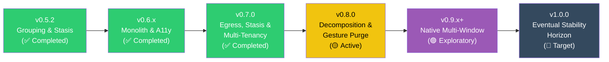

# FNQ Unified Development Roadmap & Tracking Board

> **Current Active Version**: 0.8.0-dev  
> (Infrastructure Decomposition & Gesture Rationalization)  
> **Strategic Focus**: Coordinator & Widget Decomposition, Gesture  
> Unification, and Dead Code Purge.  
> **Baseline Quality**: `flutter analyze --fatal-warnings` — 0 issues |  
> `flutter test` — 425/425 passing | `example test` — 63/63 passing.

---

## 🧭 Evolution Strategy & Versioning Philosophy

> [!NOTE]
> **Maturation & Working Hypotheses**: Pre-1.0 Semantic Versioning (`0.y.z`)
> represents an exploratory, foundational phase. Versioning projections
> (`0.8.x`, `0.9.x`, etc.) and milestone boundaries in this roadmap are
> **surface anticipations and working hypotheses**, not rigid commitments.
> The project will progress through as many minor releases (`0.8`, `0.9`,
> `0.10`, etc.) as required to thoroughly battle-test infrastructure and
> resolve real-world edge cases.

The immediate objective across the `0.7.x` and `0.8.x` cycles is to **mature
and stress-test core infrastructure** under real-world conditions:
1. **Multi-Tenancy Reality Testing (v0.7.x)**: Validate 1:1 controller
   isolation, independent stasis tokens, and clean teardowns in the Studio
   split-viewport stage without third-party dependencies.
2. **Gesture Rationalization (v0.8.x)**: Collapse fragmented spatial plugins
   (`Reorder`, `Relocate`, `ReorderAndRelocate`) into a single, seamless
   spatial movement engine, move `Pin` and `Snooze` into a dedicated card
   action model, and purge legacy `DismissZone` dead code.
3. **Native Multi-Window & Multi-View (v0.9.x+)**: Introduce 1:N multi-view
   coordination once upstream Flutter desktop multi-view settles.
4. **Infrastructure Hardening**: High-throughput bursts, 120Hz frame budgets,
   and leak-free ticker teardowns.



| Release Tier | Focus / Theme | Status | Strategic Deliverables |
|---|---|---|---|
| **v0.5.0–v0.5.2** | **Stability & Grouping** | ✅ Completed | Snooze timer cleanup, error chaining, single source-of-truth pinning, `GroupCountBehavior`, peek card timer stasis. |
| **v0.6.0–v0.6.1** | **Monolith & Platform** | ✅ Completed | 26-part monolith decomposition, WCAG 2.1 AA accessibility, desktop context menu engine, `NotificationThemeData`. |
| **v0.7.0–v0.7.1** | **Egress, Stasis, Multi-Tenancy & Delegates** | ✅ Completed | Card-centric egress (`DismissEgress`), flight portal (`EgressFlightOverlay`), token invariant engine (`TimerPauseReason`), queue stasis, cross-queue slot relocation, Studio split-viewport multi-tenancy validation, atomic `clearBacklog`, `QueueStasisManager` & `QueueA11yAnnouncer` delegates, `logd` ^0.10.6. |
| **v0.8.0** | **Decomposition & Gesture Purge** | 🟡 Active | Decompose `QueueCoordinator` and `NotificationWidget` into delegates/components, unify spatial movement (`Reorder`/`Relocate` $\to$ 1 engine), card action framework, `DismissZone` dead code purge (~1,200 LOC). |
| **v0.9.x+** | **Native Multi-Window & Multi-View** | 🟣 Exploratory | 1:N multi-view coordination inside `NotificationController`, active-window routing, multi-display DPI invariance, 120Hz stress profiling. |
| **v1.0.0** | **Eventual Stability Horizon** | 🎯 Target | Long-term API freeze and enterprise production guarantee, declared only after infrastructure is proven in real-world apps. |

---

## 📊 Status Board & Complexity Matrix

```
Priority Tiers:
🔴 P0 (Critical) : Eliminates crash vectors, resource leaks, or correctness bugs.
🟡 P1 (High)     : High-impact performance optimizations and architectural guardrails.
🟢 P2 (Medium)   : Code quality improvements, ergonomics, and accessibility enhancements.
🔵 P3 (Low)      : Edge-case optimizations and cosmetic styling refinements.

Complexity Tiers:
🟢 Low    : Localized parameter adjustments, documentation, or basic unit tests.
🟡 Medium : State machine updates, lifecycle coordination, caching, or data model changes.
🔴 High   : Cross-subsystem refactorings, multi-file monolith decomposition, or layout pipeline shifts.
```

---

## 📋 Comprehensive Task Tracking Boards

### Track 1: Release 0.5.0 — Stability Foundation (Completed ✅)

| ID | Task Description | Priority | Complexity | Status | Target Files |
|---|---|---|---|---|---|
| **S-01** | Track and cancel snooze timers on coordinator detach/dispose | 🔴 P0 | 🟢 Low | ✅ Completed | `lib/src/core/queue_coordinator.dart` |
| **S-02** | Add `_isDisposed` guard & idempotent disposal to controller and coordinator | 🔴 P0 | 🟢 Low | ✅ Completed | `lib/src/core/notification_controller.dart`, `lib/src/core/queue_coordinator.dart` |
| **S-03** | Fix `FlutterError.onError` chaining (non-destructive handler preservation) | 🔴 P0 | 🟢 Low | ✅ Completed | `lib/src/core/notification_controller.dart` |
| **S-04** | Replace bare `on Object catch (_) {}` with structured contextual logging | 🟡 P1 | 🟢 Low | ✅ Completed | `lib/src/core/queue_coordinator.dart` |
| **S-05** | Unify `isPinned` state: single source-of-truth via `blueprint.isPinnedNotifier` | 🟡 P1 | 🟡 Medium | ✅ Completed | `lib/src/core/notification_entry.dart`, `lib/src/core/queue_coordinator.dart` |
| **S-06** | Add `_isDisposed` guard to snooze timer auto-requeue callback | 🟡 P1 | 🟢 Low | ✅ Completed | `lib/src/core/queue_coordinator.dart` |
| **S-07** | Regenerate goldens & configure `_TolerantGoldenComparator` (0.5% tolerance) | 🟡 P1 | 🟢 Low | ✅ Completed | `test/golden/visual_regression_test.dart` |
| **S-08** | Resolve all open `todo` blocks in source code with definitive documentation | 🟢 P2 | 🟢 Low | ✅ Completed | `lib/src/notification/app_notification.dart`, `lib/src/notification/theme/notification_theme.dart`, `lib/src/notification/notification.dart` |

---

### Track 2: Release 0.5.2 — Grouping UX & Performance Polish (Completed ✅)

| ID | Task Description | Priority | Complexity | Status | Target Files |
|---|---|---|---|---|---|
| **G-01** | Configurable group count API (`GroupCountBehavior`: `HiddenCount`, `TotalCount`, `NoCount`, `CustomCount`) | 🔴 P0 | 🟡 Medium | ✅ Completed | `lib/src/notification_queue/group_count_behavior.dart`, `queue_grouping_behavior.dart` |
| **G-02** | Peek card timer stasis & drag auto-dismiss suspension on representative cards | 🔴 P0 | 🟡 Medium | ✅ Completed | `draggable_transitions.dart`, `queue_group_widget.dart` |
| **G-03** | Atomic whole-bundle dismiss & backlog purging | 🔴 P0 | 🟡 Medium | ✅ Completed | `lib/src/core/queue_coordinator.dart`, `queue_group_widget.dart` |
| **P-01** | CurvedAnimation ticker leak prevention across drag snap-back & collapse | 🔴 P0 | 🟢 Low | ✅ Completed | `draggable_transitions.dart`, `queue_group_widget.dart` |
| **P-02** | Relocation mapping integrity & duplicate GlobalKey collision hardening | 🟡 P1 | 🟢 Low | ✅ Completed | `lib/src/core/queue_coordinator.dart` |
| **P-03** | Context-aware `View.maybeOf(context)` multi-window modernization | 🟡 P1 | 🟢 Low | ✅ Completed | `lib/src/core/notification_overlay.dart` |
| **P-04** | Reorder 120Hz smoothness with memoized layout snapshots | 🟡 P1 | 🟢 Low | ✅ Completed | `lib/src/notification_queue/queue_widget.dart` |

---

### Track 3: Release 0.6.0 — Architecture & Encapsulation (Completed ✅)

| ID | Task Description | Priority | Complexity | Status | Target Files |
|---|---|---|---|---|---|
| **A-01** | Decompose 26-file `notification.dart` `part` monolith into distinct sub-libraries | 🟡 P1 | 🔴 High | ✅ Completed | `lib/src/notification/` |
| **A-02** | Extract `NotificationTheme` system from notification `part` into standalone library | 🟡 P1 | 🟡 Medium | ✅ Completed | `lib/src/notification/theme/notification_theme.dart` |
| **A-03** | Extract duplicate coordinator resolution into shared mixin (`CoordinatorResolver`) | 🟢 P2 | 🟢 Low | ✅ Completed | `lib/src/notification/notification.dart`, `lib/src/notification/interaction/widgets/draggable_transitions.dart`, `lib/src/notification_queue/queue_widget.dart` |
| **A-04** | Encapsulate `ConfigurationManager` fields (make private, enforce immutability) | 🟢 P2 | 🟢 Low | ✅ Completed | `lib/src/core/configuration_manager.dart` |
| **A-05** | Add `NotificationWidget? get notification` accessor to sealed `NotificationEvent` | 🟢 P2 | 🟢 Low | ✅ Completed | `lib/src/core/notification_event.dart`, `lib/src/core/history_logger.dart` |
| **A-06** | Replace static mutable `_idCounter` with instance-scoped ID generator | 🟢 P2 | 🟢 Low | ✅ Completed | `lib/src/notification/notification.dart` |
| **A-07** | Enforce 3-Tier Hierarchy: Deprecate per-notification `dragBehavior` physics overrides | 🟡 P1 | 🟡 Medium | ✅ Completed | `lib/src/notification/app_notification.dart`, `lib/src/notification/notification.dart` |
| **A-08** | Migrate channel & notification theming to `NotificationThemeData`; eliminate loose scalar colors | 🟡 P1 | 🟡 Medium | ✅ Completed | `lib/src/notification_channel/notification_channel.dart`, `lib/src/notification/app_notification.dart` |
| **A-09** | Decouple `AppNotification.position`: route via channel defaults or `controller.show(..., targetPosition:)` | 🟡 P1 | 🟢 Low | ✅ Completed | `lib/src/notification/app_notification.dart`, `lib/src/core/notification_controller.dart` |
| **A-10** | Payload hygiene: remove leaked `snoozedAt` from public constructor, unify `permanent` vs `initialIsPinned` | 🟢 P2 | 🟢 Low | ✅ Completed | `lib/src/notification/app_notification.dart`, `lib/src/core/notification_entry.dart` |

---

### Track 5: Release 0.7.0 — Egress, Stasis, Multi-Tenancy & Studio Canvas (Completed ✅)

| ID | Task Description | Priority | Complexity | Status | Target Files |
|---|---|---|---|---|---|
| **E-01** | Sealed `DismissEgress` hierarchy (`horizontal`, `natural`, `outward`, `cross`, `any`) | 🔴 P0 | 🟡 Medium | ✅ Completed | `lib/src/notification/interaction/behaviors/drag_behavior.dart` |
| **E-02** | Dual-threshold commitment (displacement fraction `dismissThreshold` + `escapeVelocity`) | 🔴 P0 | 🟡 Medium | ✅ Completed | `lib/src/notification/interaction/widgets/draggable_transitions.dart` |
| **E-03** | In-slot reveal underlay (`EgressUnderlay`) and tactile card tilt feedback | 🟡 P1 | 🟡 Medium | ✅ Completed | `lib/src/notification/interaction/widgets/egress_underlay.dart` |
| **E-04** | Inertial exit flight portal (`EgressFlightOverlay`) with release velocity conservation | 🟡 P1 | 🟡 Medium | ✅ Completed | `lib/src/notification/interaction/widgets/egress_flight_overlay.dart` |
| **E-05** | Auto-dismiss timer preservation across drag start/cancel (`pauseDismissTimer` / `resumeDismissTimer`) | 🔴 P0 | 🟢 Low | ✅ Completed | `lib/src/notification/notification_widget_state.dart` |
| **E-06** | Cross-queue slot relocation engine with live destination insertion previews | 🔴 P0 | 🔴 High | ✅ Completed | `lib/src/notification/interaction/plugins/relocate_gesture_plugin.dart`, `queue_coordinator.dart` |
| **E-07** | Keyboard modifier key isolation (`Ctrl`, `Cmd`, `Alt`, `Shift`) and post-drag card `unfocus()` | 🟢 P2 | 🟢 Low | ✅ Completed | `lib/src/notification/notification.dart` |
| **E-08** | Schedule `DismissZone` and `Dismiss.zones` deprecation for removal in `v0.8.0` | 🟡 P1 | 🟢 Low | ✅ Completed | `lib/src/notification/interaction/behaviors/` |
| **E-09** | Harmonize `Relocate` with whole-queue container semantics (preserving destination queue sorting) | 🟡 P1 | 🟡 Medium | ✅ Completed | `lib/src/notification/interaction/plugins/relocate.dart` |
| **E-10** | Multi-stage visual feedback pipeline for whole-queue relocation (halo border & reception pill) | 🟡 P1 | 🟡 Medium | ✅ Completed | `lib/src/notification_queue/queue_external_drop.dart`, `queue_widget.dart` |
| **E-11** | Hardened `Pin`, `Snooze`, and `CustomAction` plugins with post-drag unfocus and timer stasis | 🟢 P2 | 🟢 Low | ✅ Completed | `lib/src/notification/interaction/plugins/` |
| **E-12** | Unified card-level invariant engine (`TimerPauseReason` tokens, idempotent dismissal) | 🔴 P0 | 🟡 Medium | ✅ Completed | `lib/src/notification/notification.dart` |
| **E-13** | Queue-level timer stasis (`NotificationTimerScope` for reorder, relocation, and programmatic pause) | 🔴 P0 | 🟡 Medium | ✅ Completed | `lib/src/notification_queue/queue_widget.dart`, `queue_coordinator.dart` |
| **E-14** | Enlarged 36x36 close button hit area & unified header expand tap region | 🟢 P2 | 🟢 Low | ✅ Completed | `lib/src/notification/notification.dart` |
| **E-15** | Studio Multi-Tenant Split-Viewport: validate concurrent 1:1 controllers, token isolation & teardowns | 🔴 P0 | 🟡 Medium | ✅ Completed | `example/`, `lib/src/core/` |
| **E-16** | Atomic backlog purging: add `clearBacklog: false` parameter to `NotificationController.dismissAll()` | 🔴 P0 | 🟢 Low | ✅ Completed | `lib/src/core/notification_controller.dart`, `queue_coordinator.dart` |
| **E-17** | Scope `HardwareKeyboard.instance.addHandler` to `widget.useRootOverlay` to prevent collisions | 🔴 P0 | 🟢 Low | ✅ Completed | `lib/src/core/notification_scope.dart` |
| **E-18** | Native Studio Virtual Multi-Window stage (`VirtualStageCanvas`, workspace switcher, radar stream rebinding) | 🟡 P1 | 🔴 High | ✅ Completed | `example/lib/studio/` |
| **E-19** | Coordinator delegate extraction (Phase 1): `QueueStasisManager` and `QueueA11yAnnouncer` | 🟡 P1 | 🟢 Low | ✅ Completed | `lib/src/core/queue_stasis_manager.dart`, `queue_a11y_announcer.dart` |
| **E-20** | Upgrade `logd` constraint to `^0.10.6` to support pure semantic logging engine | 🟢 P2 | 🟢 Low | ✅ Completed | `pubspec.yaml` |

---

### Track 6: Release 0.8.0 — Architecture Decomposition & Gesture Rationalization (Active 🟡)

| ID | Task Description | Priority | Complexity | Status | Target Files |
|---|---|---|---|---|---|
| **R-01** | Remove deprecated `enum DismissZone` and `Dismiss.zones` constructor parameter | 🔴 P0 | 🟢 Low | 📅 Planned | `lib/src/behaviors/drag_behavior.dart` |
| **R-02** | Delete legacy screen-edge target machinery (`DismissalTargets` ~916 LOC, `DismissFeedbackOverlay`) | 🟡 P1 | 🟡 Medium | 📅 Planned | `lib/src/notification/interaction/overlays/` |
| **R-03** | Convert `DismissGesturePlugin` to pure egress without legacy zone bridges | 🟡 P1 | 🟢 Low | 📅 Planned | `lib/src/notification/interaction/plugins/dismiss.dart` |
| **R-04** | Unified Spatial Movement: consolidate `Reorder`, `Relocate`, and `ReorderAndRelocate` into one engine | 🔴 P0 | 🔴 High | 📅 Planned | `lib/src/behaviors/drag_behavior.dart`, `plugins/` |
| **R-05** | Rationalized Card Actions: decouple `Pin` and `Snooze` from full-card drag behaviors into card action model | 🟡 P1 | 🟡 Medium | 📅 Planned | `lib/src/behaviors/drag_intents.dart`, `plugins/` |
| **R-06** | Align Studio configurator, code generator, and docs with rationalized interaction vocabulary | 🟢 P2 | 🟢 Low | 📅 Planned | `example/`, `doc/` |
| **R-07** | Decompose `QueueCoordinator` into delegates (`QueueRelocationEngine`, `QueueStasisManager`, `QueueA11yAnnouncer`) | 🔴 P0 | 🔴 High | 🟡 In Progress | `lib/src/core/queue_coordinator.dart`, `lib/src/core/delegates/` |
| **R-08** | Decompose `NotificationWidget` into subcomponents (`NotificationProgressBar`, `NotificationSwipeDismissible`) | 🟡 P1 | 🟡 Medium | 📅 Planned | `lib/src/notification/` |
| **R-09** | Strongly-typed channel identifiers and tokens replacing loose strings | 🟢 P2 | 🟢 Low | 📅 Planned | `lib/src/channel/` |

---

### Track 7: Release 0.9.x+ — Native Multi-Window & 1:N Multi-View (Exploratory 🟣)

| ID | Task Description | Priority | Complexity | Status | Target Files |
|---|---|---|---|---|---|
| **W-01** | 1:N Multi-View Controller Architecture (`targetView`, active-window routing, broadcast mode) | 🔴 P0 | 🔴 High | 🟣 Exploratory | `lib/src/core/notification_controller.dart` |
| **W-02** | View-scoped `OverlayPortal` & `DropTargetRegistry` coordinates across native `FlutterView`s | 🟡 P1 | 🔴 High | 🟣 Exploratory | `lib/src/core/notification_scope.dart`, `drop_target_registry.dart` |
| **W-03** | Multi-display DPI invariance across heterogeneous monitors and dynamic scaling shifts | 🟡 P1 | 🟡 Medium | 🟣 Exploratory | `lib/src/notification/interaction/` |
| **W-04** | High-throughput 120Hz stress profiling under concurrent multi-view queues | 🟢 P2 | 🟡 Medium | 🟣 Exploratory | `benchmark/`, `test/stress/` |

---

### Track 8: Advanced Features & Platform Perfection (F-Series)

| ID | Feature / Job Name | Phase | Priority | Complexity | Status | Target Files |
|---|---|---|---|---|---|---|
| **F-01** | Drag-to-Reorder within Queue | Phase 2 | *Critical* | 🔴 High | ✅ Completed | `lib/src/notification_queue/queue_widget.dart` |
| **F-02** | Pin-to-Edge Interaction (Pinning) | Phase 2 | *Critical* | 🟡 Medium | ✅ Completed | `lib/src/notification/notification.dart` |
| **F-03** | Desktop Parking & Runtime Config | Phase 2 | 🟢 P2 | 🟡 Medium | ✅ Completed | `lib/src/core/queue_coordinator.dart`, `lib/src/core/parking_manager.dart` |
| **F-04** | Notification Grouping (Bundling) | Phase 3 | *Critical* | 🔴 High | ✅ Completed | `lib/src/notification_queue/queue_widget.dart` |
| **F-05** | In-App History Logger & Querying | Phase 3 | 🟢 P2 | 🟡 Medium | ✅ Completed | `lib/src/core/history_logger.dart` |
| **F-06** | [Focus Traversal & Accessibility](specs/accessibility.md) | Phase 5 | 🟢 P2 | 🟢 Low | ✅ Completed | `lib/src/core/notification_overlay.dart` |
| **F-07** | Context Menu Support (Right-click) | Phase 5 | 🔵 P3 | 🟢 Low | ✅ Completed | `lib/src/notification/notification.dart` |
| **F-08** | L-Shaped Unified Corner Bars | Phase 2 | 🔵 P3 | 🟡 Medium | ✅ Completed | `lib/src/notification/interaction/overlays/dismissal_targets.dart` |
| **F-09** | Smart Layout & Overlap Avoidance | Phase 3 | *Critical* | 🔴 High | ✅ Completed | `lib/src/core/notification_overlay.dart` |
| **F-10** | Keyboard Shortcuts (`Esc` / `Shift+Esc`) | Phase 5 | *Critical* | 🟡 Medium | ✅ Completed | `lib/src/core/notification_overlay.dart` |
| **F-11** | Visual Golden Verification Suite | Phase 4 | *Critical* | 🟡 Medium | ✅ Completed | `test/golden/visual_regression_test.dart` |

---

## 🛠️ Feature & Optimization Deep Dives

### P-01: O(1) Notification ID Indexing
* **Target Release**: v0.5.1
* **Objective**: Coordinator operations like `dismiss()`, `relocate()`, `snooze()`, `pin()`, and `unpin()` currently perform linear scans across `activeNotifications` ($O(n \times m)$).
* **Implementation Plan**:
  * Introduce an internal `Map<String, NotificationEntry> _activeById` inside `QueueCoordinator`.
  * Update `_activeById` synchronously upon item enqueue, dequeue, and relocation.
  * Direct all lookup-by-ID operations directly to the map for immediate $O(1)$ resolution.

### P-02: Queue Item Partition Memoization
* **Target Release**: v0.5.1
* **Objective**: `QueueWidgetState._partitionItems()` partitions visible vs. bundled vs. pinned notifications by allocating fresh lists and sets on every build frame.
* **Implementation Plan**:
  * Store cached partition records (`_cachedPartition`).
  * Invalidate cache only when underlying queue items are added, removed, or their pinned state changes.

### A-01: Monolith Decomposition (`notification.dart`)
* **Target Release**: v0.6.0
* **Objective**: `notification.dart` currently contains 26 `part` files sharing a single flat private namespace.
* **Implementation Plan**:
  * Extract interaction plugins into dedicated library units under `lib/src/notification/interaction/`.
  * Export public plugins cleanly through `lib/src/notification/plugins.dart`.
  * Enforce clear encapsulation boundaries with `@internal` annotations where appropriate.

### A-08: Theme Token Migration & Loose Color Deprecation
* **Target Release**: v0.6.0 (with deprecations in v0.5.x)
* **Objective**: Replace fragmented scalar `Color?` fields on `AppNotification` and `NotificationChannel` with cohesive, dark-mode reactive `NotificationThemeData`.
* **Migration Plan**:
  * **Phase 1 (v0.5.x)**: Annotate `color`, `backgroundColor`, and `foregroundColor` on `AppNotification` and `NotificationChannel` with `@Deprecated`. Synthesize an internal `NotificationThemeData` fallback to maintain 100% backward compatibility.
  * **Phase 2 (v0.6.0)**: Remove loose scalar parameters and provide standard migration documentation in `doc/migration_theming.md`.

### F-06: Focus Traversal & Semantic Accessibility
* **Target Release**: v0.6.x
* **Detailed Specification**: See [Accessibility & Focus Traversal Specification](specs/accessibility.md).
* **Objective**: Ensure notifications meet WCAG and Flutter accessibility standards.
* **Implementation Plan**:
  * Implement `NotificationA11yOptions` on controller and overlay.
  * Wrap notifications in semantic containers with proper accessibility labels.
  * Support keyboard tab navigation and `Alt + N` focus handoff across visible notifications.
  * Allow screen readers to announce incoming notifications via `SemanticsService.announce`.

---

## 📦 Completed Release History (Tags)

| Release | Date | Highlights | Key Files Modified |
|---|---|---|---|
| **v0.6.1** | 2026-11-10 | **Platform Hardening & Semantic A11y**: Added `NotificationA11yOptions`, desktop right-click context menu engine, keyboard shortcut modifier isolation (`Ctrl`, `Cmd`, `Alt`, `Shift`), post-drag card `unfocus()`. | `lib/src/notification/`, `lib/src/core/notification_overlay.dart`, `specs/accessibility.md` |
| **v0.6.0** | 2026-11-08 | **Monolith Decomposition**: Decomposed 26-part `notification.dart` monolith into distinct sub-libraries (`theme/`, `interaction/`, `widgets/`), extracted `CoordinatorResolver` mixin, sealed `NotificationEvent` enhancements. | `lib/src/notification/`, `lib/src/core/` |
| **v0.5.2** | 2026-11-05 | **Grouping UX & Performance Polish**: Introduced `GroupCountBehavior` hierarchy (`HiddenCount`, `TotalCount`, `NoCount`, `CustomCount`); peek card timer stasis & drag auto-dismiss suspension; expanded bundle timer pause; atomic bundle dismiss & backlog purging; `CurvedAnimation` leak fixes; duplicate GlobalKey collision hardening; coordinator tracking cleanup; reorder 120Hz smooth memoized snapshots. | `lib/src/notification_queue/`, `lib/src/core/queue_coordinator.dart`, `example/` |
| **v0.5.1** | 2026-10-27 | **Account Migration**: Updated repository, homepage, demo URL, and documentation links for account migration to `pccria`. | `pubspec.yaml`, `README.md`, `doc/` |
| **v0.5.0** | 2026-10-12 | **Stability Foundation**: Snooze timer lifecycle tracking & leak prevention; idempotent `dispose()` on `NotificationController` and `QueueCoordinator`; non-destructive `FlutterError.onError` handler chaining; single source-of-truth `isPinnedNotifier` state binding; tolerant golden comparator (0.5% threshold); resolved all source TODOs; added lifecycle & chaining test suite. | `lib/src/core/queue_coordinator.dart`, `lib/src/core/notification_controller.dart`, `lib/src/core/notification_entry.dart`, `test/golden/visual_regression_test.dart`, `test/src/core/` |
| **v0.4.1** | 2026-09-12 | **Studio Web Release Fix**: Fixed minified type name display in Studio web configurator. | `example/` |
| **v0.4.0** | 2026-08-30 | **Zero Deprecated Surface & Pure Architecture**: Complete removal of legacy static singletons (`FlutterNotificationQueue`), deprecated `FnqEvent` typedefs, and legacy action factories. Standardized 100% on `NotificationController`, `NotificationScope`, and `AppNotification`. | `lib/flutter_notification_queue.dart`, `lib/src/core/` |
| **v0.3.2** | 2026-08-26 | **Studio Web App & CI/CD Pipeline**: GitHub Pages deployment workflow (`deploy_pages.yml`), live demo badges, and mobile responsive Studio UI. | `.github/workflows/deploy_pages.yml`, `example/` |
| **v0.3.1** | 2026-08-14 | **Memory & Teardown Hardening**: Automated timer & animation ticker disposal (`ditchAllDismissTimers`), OverlayPortal detachment, and multi-tenant scope test suite. | `lib/src/core/queue_coordinator.dart`, `lib/src/notification_queue/queue_widget.dart` |
| **v0.3.0** | 2026-08-14 | **Multi-Tenant Architecture**: Introduced `NotificationController`, `NotificationScope`, `AppNotification`, sealed `NotificationEvent` hierarchy. | `lib/src/core/notification_scope.dart`, `lib/src/core/notification_controller.dart` |
| **v0.2.0** | 2026-07-19 | **Core Engine Features**: Notification Grouping (F-04), Drag-to-Reorder (F-01), Pinning (F-02), Smart Layout (F-09), Shortcuts (F-10), Visual Goldens (F-11). | `lib/src/notification_queue/`, `lib/src/notification/` |
